# Lending Game — Part 1: Exploratory Data Analysis (detailed report)

Long-form companion to [`eda_report.md`](eda_report.md), written as source material for the final
course report. It carries the same findings and the same recommendations, but adds the method
behind each number, the full tables, and the reasoning for and against each conclusion.

Everything is reproduced by `analysis/eda.ipynb`, which runs end-to-end.
No model is fitted beyond univariate AUC used as a descriptive statistic.

We are **lender 3**: `signal3` is ours, `signal1` and `signal2` are the other two lenders' and are
visible only in the historical file.

---

## Summary

- **Income dominates.** AUC 0.710 alone, far ahead of everything else. Log-transforming adds no
  information (AUC is invariant to monotone transforms) but makes the relationship linear in the
  log-odds: R² of a linear fit rises 0.713 → 0.965. **Recommendation: log-transform.**
- **`income == 0` is a structural zero and a large separate risk marker.** 17.0% of applicants,
  confined to students and the unemployed, 20.19% vs 7.84% default, and it survives within both
  groups (+11.06 pp, +18.00 pp). **Recommendation: add an `income == 0` flag.**
- **The employment risk ordering reverses once the income-zero rows are removed** (rank
  correlation −0.60) — confounding, not a property of employment. **Recommendation: one-hot, not
  ordinal**; whether an explicit interaction beats flag-plus-dummies is left open.
- **~21% of every signal is exactly `0`, and four independent checks say it means "no signal
  received"**, not a low score. **Recommendation: don't feed the zeros in as the number `0`.**
- **The three signals are interchangeable and non-redundant** (AUC 0.5429 / 0.5425 / 0.5446;
  mutual correlation ≈ 0.18) **but all three track employment strongly** (η ≈ 0.40), so employment
  and the signals carry overlapping information.
- **The new applicants are the same population** as the past loans on every input we can test.

---

## 1. Scope, data and method

### 1.1 The two files

| | `PastLoans.csv` | `NewApplications_Lender3_Round1.csv` |
|---|---|---|
| Rows × columns | 100,000 × 8 | 100,000 × 6 |
| `id` | absent | `int64`, 1…100,000, unique, contiguous |
| `sex` | `str` | `str` |
| `employment` | `str` | `str` |
| `married` | `int64` | `int64` |
| `income` | `int64` | `int64` |
| `signal1`, `signal2` | `float64` | absent |
| `signal3` | `float64` | `float64` |
| `default` | `int64` | absent |

`PastLoans` has **no identifier**, so historical loans cannot be linked to new applicants; any
model must transfer through the feature values alone.

### 1.2 Methodological conventions

These apply throughout and are worth stating once, since several of the conclusions depend on
them.

**Confidence intervals.** Every grouped or binned default rate carries a 95% **Wilson score
interval**, used in preference to the normal approximation because several bins have small `n` or
rates close to 0 (the top income bin is 0.24%; the 71 top-coded applicants have zero defaults).

**Binning the signals.** The signal zeros are binned as **their own group**, with the quantile
bins computed on the strictly positive values only — 1 + 10 bins of 21,055 and ~7,895 rows. Bin
counts are shown in every signal table.

**AUC conventions.** AUC is oriented so higher means more predictive. Because a *higher* signal
means *lower* risk, the score used is the negated variable. Two consequences matter:

- **AUC is invariant to any strictly monotone transform.** `income` and `log1p(income)` therefore
  have *identical* AUC (0.7095 both). Any claim that logging "improves" a variable's predictive
  power is wrong by construction; what logging changes is functional form.
- **Categorical variables** are scored by their in-sample group default rate. With ≤4 levels and
  100,000 rows this is a reasonable reading of standalone power, but it uses the target to order
  the levels, so those figures are very slightly optimistic.

**Association measures for mixed types.** For two numeric variables, Pearson and Spearman. For a
numeric variable against a categorical one, **η (eta)** — the square root of the one-way ANOVA
R², i.e. the share of the numeric variable's variation explained by the grouping. η is on the
same 0–1 scale as a correlation magnitude, which makes the comparisons in section 7 readable.

**Bootstrap.** The AUC difference in 5.5 is given a **paired bootstrap** interval: rows are
resampled once and both statistics computed on that same resample, keeping the comparison
like-for-like. 400 resamples, seed 42, read from `src/config.py` along with all file paths.

---

## 2. Data quality

### 2.1 Completeness

**Zero missing values** in every column of both files — no `NaN`, no empty strings, no sentinel
values other than the structural ones discussed below. This is unusual for credit data and
suggests a simulated dataset.

### 2.2 Duplicates, and reconciling three different counts

`PastLoans` contains **68 exactly-duplicated rows**. Before treating that as a defect it is worth
asking *where* they sit, because the signals carry 8 significant digits — two independent
borrowers should essentially never collide unless their signals are all exactly 0.

They don't. **Every duplicate falls inside the 1,258 rows where all three signals are 0**, and
there are **zero duplicates among the 98,742 rows with at least one positive signal.** Once all
three signals are 0, a row is pinned down by `(sex, employment, married, income)` alone, and
collisions become arithmetically unavoidable.

Three different numbers appear in the notebook output, and they measure three different things:

| quantity | value | what it counts |
|---|---|---|
| all-signals-zero rows | 1,258 | rows where `signal1 = signal2 = signal3 = 0` |
| distinct **public profiles** among them | 1,185 | distinct `(sex, employment, married, income)` |
| rows beyond one per public profile | **73** | `1,258 − 1,185` |
| profile groups whose rows differ in `default` | 5 | collisions broken by the outcome column |
| distinct **full rows** (all 8 columns) | 1,190 | `1,185 + 5` |
| **exact duplicates**, `.duplicated()` | **68** | `1,258 − 1,190`, equivalently `73 − 5` |
| rows involved, `.duplicated(keep=False)` | **79** | every row belonging to a duplicate group |

**Why 73 ≠ 68.** A shared public profile only becomes a true duplicate when the two borrowers
*also* share an outcome. In 5 of those groups one borrower defaulted and the other did not, which
keeps the rows distinguishable: `73 − 5 = 68`.

**Why 79 ≠ 68.** These are the two pandas conventions. The 79 rows form **11 duplicate groups**
of sizes 2, 2, 2, 2, 3, 6, 8, 10, 10, 13, 21; `.duplicated()` counts only the repeats, so
`79 − 11 = 68`.

*(A coincidence worth flagging so nobody trips over it: 73 is also the number of those 79 involved
rows that have `income == 0`. Different quantity, same value. The remaining 6 are retired
applicants who happened to share an income figure — €4,525, €4,711 and €6,659.)*

**Reading:** these are distinct borrowers with identical recorded values, not repeated records.
See recommendation 10.7.

### 2.3 Categorical coding is identical across files

| variable | levels | PastLoans % | NewApplications % | max diff |
|---|---|---|---|---|
| `sex` | `'F'`, `'M'` | 42.67 / 57.33 | 42.83 / 57.17 | 0.16 pp |
| `employment` | `'employed'`, `'retired'`, `'student'`, `'unemployed'` | 57.94 / 11.58 / 16.18 / 14.30 | 57.82 / 11.59 / 16.05 / 14.54 | 0.24 pp |
| `married` | `0`, `1` | 39.18 / 60.82 | 38.90 / 61.10 | 0.28 pp |

Levels were compared with `repr()` so whitespace or case differences would surface. Exactly **four
employment categories**, as the brief states; no extra levels, none present in one file and absent
from the other. An encoder fitted on `PastLoans` will transfer without surprises.

### 2.4 Ranges, top-coding and structural zeros

No negative incomes, nothing above the €1M cap, no signal outside `[0, 1]`, no `married` or
`default` value outside `{0, 1}`.

- **Income top-code:** 71 rows at exactly €1,000,000 in PastLoans (0.071%), 82 in the new file
  (0.082%). The next highest observed incomes are €996,721 and €999,902, so the cap is a genuine
  pile-up rather than a round-number coincidence.
- **Income zeros:** 17,035 rows (17.04%) in PastLoans, 17,159 (17.16%) in the new file.
- **Signal zeros:** 20.84% / 20.90% / 21.06% in PastLoans, 20.94% for `signal3` in the new file.

---

## 3. The target

| | count | share |
|---|---|---|
| repaid (`default = 0`) | 90,053 | 90.05% |
| defaulted (`default = 1`) | 9,947 | 9.95% |

**Overall default rate 9.947%**, 95% CI [9.763%, 10.134%]. Class ratio ≈ 1:9.

The imbalance is moderate: 9,947 positive cases is ample for estimating group rates, and every
subgroup examined below retains enough defaults for a usably narrow interval.

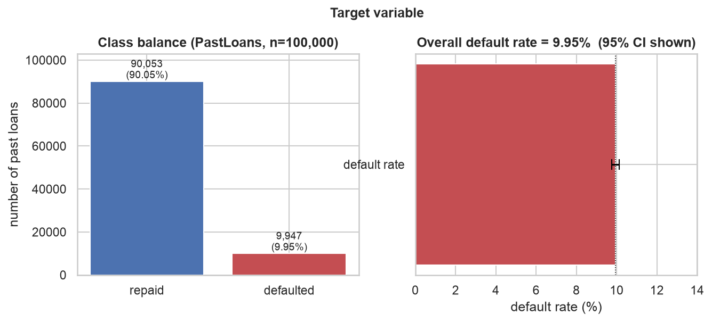

---

## 4. Univariate distributions

### 4.1 Categorical variables

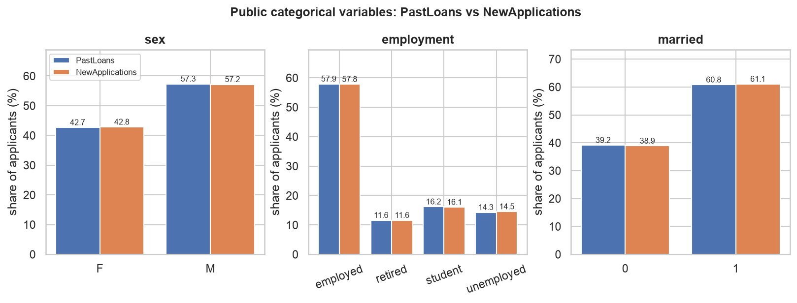

### 4.2 Income

| statistic | value |
|---|---|
| mean | €18,646 |
| median | €9,370 |
| standard deviation | €48,178 |
| skewness | **11.94** |
| kurtosis | 193.68 |
| 99th percentile | €179,541 |
| 99.9th percentile | €805,330 |
| maximum | €1,000,000 (top-code) |

The mean is 2.0× the median — a severely right-skewed distribution. Skewness of `log1p(income)`
is **−1.56** across all rows, but **+0.90** once the structural zeros are set aside: the log
transform only produces a near-symmetric variable if the zeros are handled separately, because
`log1p(0) = 0` parks 17,035 observations far below the rest of the distribution.

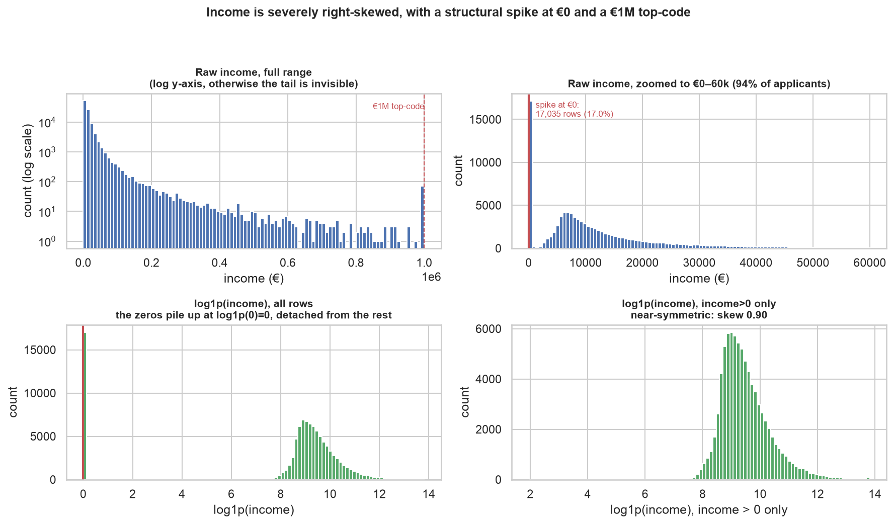

**Who has income 0:**

| employment | n | with `income == 0` | share |
|---|---|---|---|
| employed | 57,936 | 0 | 0.00% |
| retired | 11,582 | 0 | 0.00% |
| student | 16,183 | 10,169 | 62.84% |
| unemployed | 14,299 | 6,866 | 48.02% |

Income 0 occurs **only** for students and the unemployed. It is a structural zero — "this person
has no earned income" — not a missing-value placeholder.

### 4.3 The signals

| | mean | sd | 5% | 50% | 95% | max | skew | share = 0 |
|---|---|---|---|---|---|---|---|---|
| `signal1` | 0.4177 | 0.3253 | 0.0 | 0.4482 | 0.9200 | 0.999975 | 0.062 | 20.84% |
| `signal2` | 0.4157 | 0.3251 | 0.0 | 0.4446 | 0.9190 | 0.999986 | 0.068 | 20.90% |
| `signal3` | 0.4149 | 0.3251 | 0.0 | 0.4409 | 0.9199 | 0.999965 | 0.073 | 21.06% |
| `signal3` (new) | 0.4162 | 0.3248 | 0.0 | 0.4464 | 0.9200 | 0.999994 | 0.066 | 20.94% |

The three marginal distributions are nearly indistinguishable — consistent with three draws from
the same mechanism. No value equals exactly 1.

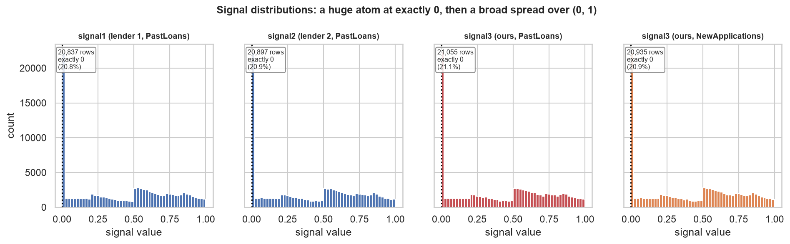

---

## 5. The zero-signal investigation

The question: is a recorded `0` a genuine *lowest possible score*, or a code meaning *no signal
was received*? The
two imply opposite treatment, since the first belongs at the risky end of the scale and the second
belongs nowhere on it.

Sections 5.1–5.4 test the question four ways; 5.5 measures how much the answer is worth.

### 5.1 Zero is a separate atom, not the bottom of a continuous distribution

| series | count at exactly 0 | count in (0, 0.005] | mean per 0.005 bin over (0, 0.05] | ratio | smallest positive value |
|---|---|---|---|---|---|
| `signal1` | 20,837 | 312 | 325 | 66.8× | 8.16e-06 |
| `signal2` | 20,897 | 339 | 328 | 61.6× | 3.22e-05 |
| `signal3` | 21,055 | 347 | 329 | 60.7× | 1.47e-05 |
| `signal3` (new) | 20,935 | 361 | 325 | 58.0× | 5.73e-06 |

Two things follow. First, the atom is roughly **60× the adjacent bin**: a single point holding 60
times the mass of a neighbouring interval of positive width is not part of a continuous density.
Second, **there is no gap** — the smallest positive values are of order 1e-5, so the continuous
part runs smoothly down towards 0 while a large point mass sits exactly on it. That is a mixture
of an atom and a density.

A density-extrapolation check puts a number on it. Estimating `f(0+)` from the positive values in
(0, 0.05], a smooth density continuing through zero would place about 650–659 observations in a
width-0.01 interval at the bottom. The observed atom is 20,837–21,055, i.e. **≈32× too many**.

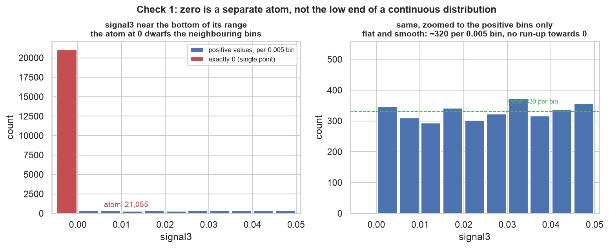

**Important caveat:** this check alone does **not** settle the question. A signal *clipped* at
zero — `signal = max(0, latent)` — would also produce an atom of size `P(latent ≤ 0)` sitting on
top of a smooth density, which is exactly this picture. Section 5.4 is what separates the two.

### 5.2 The three lenders' zeros barely coincide

| number of signals equal to 0 | observed | expected if independent | obs / exp |
|---|---|---|---|
| 0 | 50,500 | 49,436 | 1.022 |
| 1 | 37,469 | 39,256 | 0.954 |
| 2 | 10,773 | 10,391 | 1.037 |
| 3 | 1,258 | 917 | **1.372** |

χ² against exact independence = 245.3 on 3 df, p = 6.8e-53. Pairwise φ between the zero
indicators: 0.0225 (1,2), 0.0336 (1,3), 0.0288 (2,3).

**Reading:** the zeros are *mostly* lender-specific — φ of 0.02–0.03 is nearly nothing — but
independence is decisively rejected, with 37% more triple-zeros than expected. If `0` meant "this
applicant is unscoreable by anyone", the three lenders would coincide far more than this. The
small shared component is explained in 5.3.

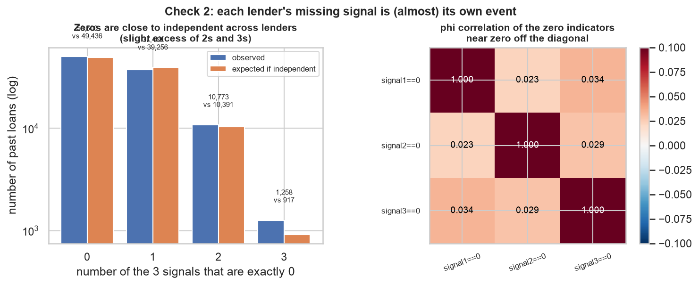

### 5.3 The zeros depend on observable characteristics

`P(signal_i = 0)`, in %:

| group | `signal1` | `signal2` | `signal3` |
|---|---|---|---|
| **employed** | 20.99 | 20.97 | 21.18 |
| **retired** | 36.30 | 35.93 | **36.50** |
| **student** | 7.73 | 7.98 | **7.85** |
| **unemployed** | 22.53 | 23.04 | 22.97 |
| not married | 17.87 | 18.02 | 18.25 |
| married | 22.75 | 22.75 | 22.86 |
| female | 21.05 | 21.38 | 21.11 |
| male | 20.68 | 20.54 | 21.01 |

Also by income decile: 13.97% in d1, 18.94% in d2, then ~21–24% across d3–d10.

**Reading:** a blank signal is far from random — retired applicants are blank more than four times
as often as students. This is also what produces the small shared component in 5.2: all three
lenders are more likely to be blank on the same retired, married applicant. A "signal was blank"
flag therefore carries a little information about *who the applicant is*, on top of the
information lost about their risk.

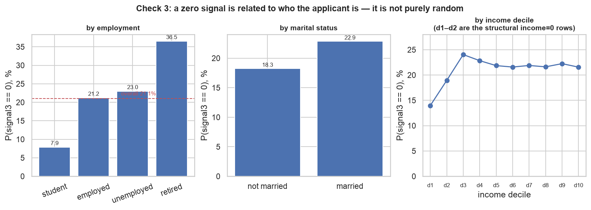

### 5.4 The decisive check: the zero group is average risk

If `0` were a clipped low score, the zero group would be the **riskiest** group of all — at least
as risky as the lowest positive decile. If `0` means "no signal received", the zero group should
look like an ordinary slice of the population.

Whole-file comparison:

| signal | `= 0` rate (n) | `> 0` rate (n) | difference | z |
|---|---|---|---|---|
| `signal1` | 9.488% (20,837) | 10.068% (79,163) | +0.58 pp | +2.53 |
| `signal2` | 9.705% (20,897) | 10.011% (79,103) | +0.31 pp | +1.33 |
| `signal3` | 9.670% (21,055) | 10.021% (78,945) | +0.35 pp | +1.53 |

Against a population rate of 9.947%, and against lowest-positive-decile rates of **16.76% /
16.09% / 16.96%**.

One composition worry has to be ruled out: retired applicants are blank far more often (36.5%)
*and* are below-average risk (8.95% vs 9.95%), so the zero group's average risk could in principle
be a mix artefact. Repeating the comparison **inside each employment category** removes that
channel:

| employment | group base rate | `signal3 = 0` rate (95% CI) | `signal3 > 0` rate | lowest positive decile |
|---|---|---|---|---|
| employed | 7.93% | 8.28% [7.80, 8.78] | 7.84% | 14.08% |
| retired | 8.95% | 9.04% [8.21, 9.94] | 8.91% | 17.39% |
| student | 12.85% | 13.30% [11.54, 15.27] | 12.82% | 21.65% |
| unemployed | 15.62% | 14.28% [13.12, 15.52] | 16.03% | 26.50% |

**In all four categories the zero group lands on its own group's base rate**, with that base rate
inside the confidence interval every time, while the lowest positive decile of the same category
runs at 14–27%. The result is not a composition artefact.

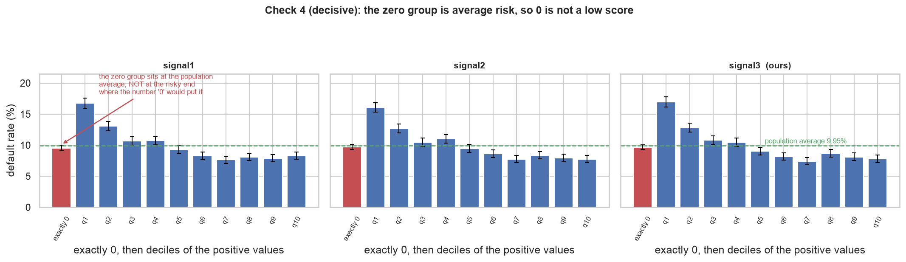

### 5.5 What the coding choice is worth

The comparison that matters is **like-for-like: the same 100,000 rows, the same target, the same
variable — only the number written into the zero cells changes.** Coding A leaves the literal `0`,
which ranks those applicants as the riskiest in the file; B and C substitute a neutral central
value, ranking them in the middle. Nothing is dropped, so the AUCs are directly comparable.

| signal | A: zeros as `0` | B: zeros as median present | C: zeros as mean present | B − A | 95% bootstrap CI for B − A |
|---|---|---|---|---|---|
| `signal1` | 0.5429 | 0.5670 | 0.5675 | +0.0240 | [+0.0195, +0.0288] |
| `signal2` | 0.5425 | 0.5631 | 0.5637 | +0.0206 | [+0.0160, +0.0253] |
| `signal3` | 0.5446 | 0.5663 | 0.5672 | **+0.0217** | [+0.0173, +0.0264] |

Paired bootstrap, 400 resamples, seed 42. **All three intervals exclude zero**, so the direction
and rough magnitude are solid: leaving the zeros at the bottom of the ranking costs about 0.02 AUC
by mislabelling ~21% of applicants as high-risk.

**What this does not settle.** The median is an arbitrary stand-in, so these numbers measure the
cost of the *worst* coding, not the gain from the *best* one.

A separate and different question — *how good is a signal when it is actually present?* — is
measured on a different row set and is not comparable with the table above:

| signal | AUC on rows where the signal is present | n |
|---|---|---|
| `signal1` | 0.5762 | 79,163 |
| `signal2` | 0.5720 | 79,103 |
| `signal3` | 0.5763 | 78,945 |

These sit above every whole-file figure, consistent with the zero rows being uninformative rather
than informative-and-low.

### 5.6 Verdict

Four independent checks point the same way across all three signals: **`signal = 0` reads as "this
lender received no signal for this applicant", recorded as `0` on the same column as real values.**
The decisive test (5.4) holds within every employment category, which is the version hardest to
explain away.

It remains an **inference** — the course brief does not say what `0` means — and the answer
determines how the signals should be encoded.

---

## 6. Each variable against `default`

### 6.1 Categorical variables

| variable | level | n | defaults | rate | 95% CI | ± pp |
|---|---|---|---|---|---|---|
| `sex` | M | 57,331 | 5,394 | 9.41% | [9.17, 9.65] | 0.24 |
| | F | 42,669 | 4,553 | 10.67% | [10.38, 10.97] | 0.29 |
| `employment` | employed | 57,936 | 4,596 | 7.93% | [7.72, 8.16] | 0.22 |
| | retired | 11,582 | 1,037 | 8.95% | [8.45, 9.49] | 0.52 |
| | student | 16,183 | 2,080 | 12.85% | [12.35, 13.38] | 0.52 |
| | unemployed | 14,299 | 2,234 | 15.62% | [15.04, 16.23] | 0.60 |
| `married` | 1 | 60,822 | 5,721 | 9.41% | [9.18, 9.64] | 0.23 |
| | 0 | 39,178 | 4,226 | 10.79% | [10.48, 11.10] | 0.31 |

Half-widths run from ±0.22 to ±0.60 pp, so all of these differences are real rather than noise.

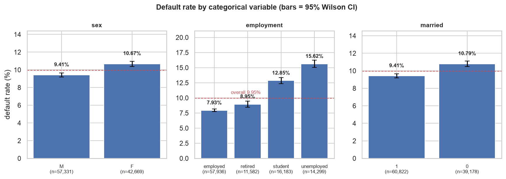

### 6.2 The employment ordering reverses — a confounding problem

Taken at face value, the four categories line up neatly, with wide gaps (1.02, 3.90, 2.77 pp) and
no overlap between any pair of neighbouring confidence intervals. That looks like a textbook case
for ordinal encoding.

It is not, because **all 17,035 income-zero rows live in exactly two of the four categories**.
Restricting to `income > 0`:

| ranking | safest → riskiest |
|---|---|
| all 100,000 applicants | employed 7.93% → retired 8.95% → student 12.85% → unemployed 15.62% |
| the 82,965 with `income > 0` | **student 5.90% → unemployed 6.98% → employed 7.93% → retired 8.95%** |

| employment | rank among all rows | rank among `income > 0` |
|---|---|---|
| employed | 1 | 3 |
| retired | 2 | 4 |
| student | 3 | 1 |
| unemployed | 4 | 2 |

Spearman rank correlation between the two orderings: **−0.60**. Employed and retired rates are
*identical* in both columns, because neither category contains any income-zero row.

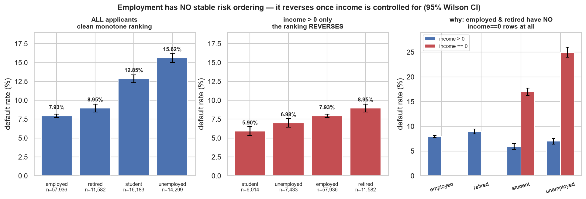

**This is confounding, not a hidden truth about employment.** The aggregate ranking is partly
measuring "has no income" wearing an employment label. Students and the unemployed *with* income
are the two safest groups in the dataset; the aggregate figures are dragged up by the income-zero
subgroups within them (16.96% and 24.98%).

Two separate conclusions follow, and it is worth keeping them apart:

1. **For encoding:** there is no stable risk ordering, so an ordinal code would impose a ranking
   that holds in one part of the data and inverts in another. One-hot avoids the problem
   (recommendation 10.4).
2. **Open question:** does an explicit `employment × income==0` interaction add anything *beyond*
   one-hot employment plus an income-zero flag? Because income-zero appears in only two of the
   four categories, those two features may already span the pattern between them.

### 6.3 `income == 0` in detail

Overall: **20.19%** [19.60, 20.80] on 17,035 rows, versus **7.84%** [7.66, 8.03] on 82,965.

Held within employment — the only two categories where the comparison exists:

| group | `income == 0` | `income > 0` | difference | se | z |
|---|---|---|---|---|---|
| student | 16.96% (n=10,169) | 5.90% (n=6,014) | **+11.06 pp** | 0.48 | +23.0 |
| unemployed | 24.98% (n=6,866) | 6.98% (n=7,433) | **+18.00 pp** | 0.60 | +30.0 |

And against quartiles of *positive* income within the same employment group, to test whether zero
is merely the continuation of "low":

| group | `income == 0` | pos Q1 | pos Q2 | pos Q3 | pos Q4 |
|---|---|---|---|---|---|
| student | **16.96%** | 12.83% (median €4,110) | 7.18% | 2.46% | 1.13% (median €26,700) |
| unemployed | **24.98%** | 14.79% (median €6,637) | 8.56% | 3.55% | 1.02% (median €26,380) |

Zero is **discontinuously worse** than the lowest positive quartile in both groups. It is a
distinct state, not an extrapolation of the income gradient.

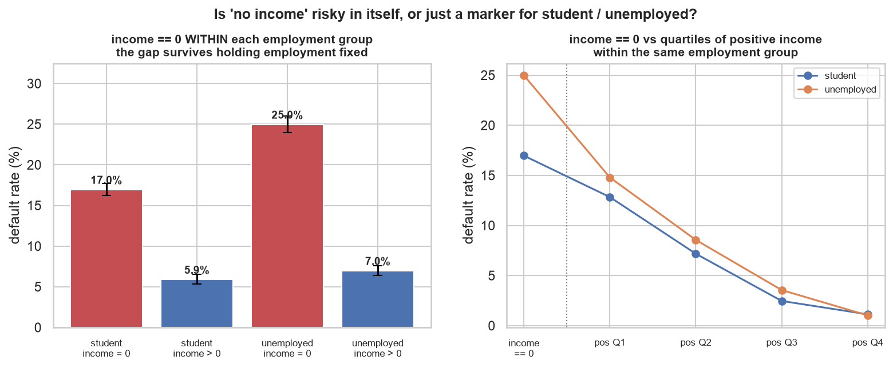

### 6.4 Income functional form

**Which rows this fit uses.** The 17,035 rows with `income == 0` are **excluded**; the fit runs on
the 82,965 rows with `income > 0` only. They have to be: `log(0)` is undefined, and the `log1p`
workaround would place all 17,035 at exactly `log1p(0) = 0`, far below the next bin, manufacturing
curvature rather than measuring it. **The R² comparison therefore says nothing about how to handle
the zeros** — that is section 6.3's separate question.

Income is cut into 20 quantile bins; each bin's default rate is converted to log-odds with a
`(k+0.5)/(n+1)` continuity correction (applied for safety, though not actually needed here — the
sparsest bin still has 10 defaults); a straight line is then fitted to the bin log-odds.

| x-axis | R² of the linear fit |
|---|---|
| raw `income` | **0.7135** |
| `log(income)` | **0.9646** |

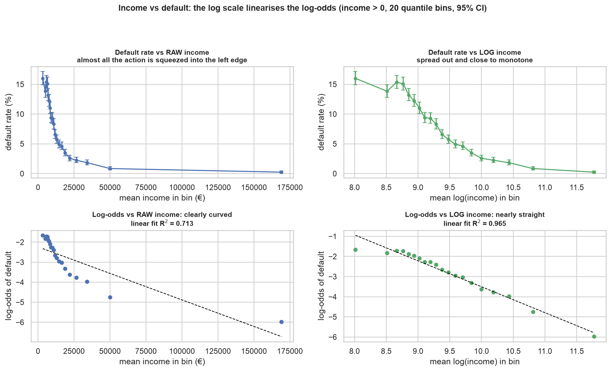

Against raw income the log-odds is strongly curved and almost all the variation is compressed into
the left edge. Against log income it is close to a straight line across the bulk of the
distribution, flattening only in the top bins where defaults become rare. Bin default rates fall
monotonically from 16.00% (mean income €3,308) to 0.24% (mean income €169,103).

### 6.5 The upper tail is near-separable

The highest income among all 9,947 defaulters is **€123,814**.

| threshold | n | defaults | rate | 95% CI |
|---|---|---|---|---|
| ≥ €25,000 | 15,705 | 195 | 1.242% | [1.08, 1.43] |
| ≥ €50,000 | 6,054 | 19 | 0.314% | [0.20, 0.49] |
| ≥ €75,000 | 3,409 | 4 | 0.117% | [0.05, 0.30] |
| ≥ €100,000 | 2,284 | 2 | 0.088% | [0.02, 0.32] |
| ≥ €125,000 | 1,646 | 0 | 0.000% | [0.00, 0.23] |
| ≥ €150,000 | 1,273 | 0 | 0.000% | [0.00, 0.30] |
| = €1,000,000 | 71 | 0 | 0.000% | **[0.00, 5.13]** |

The confidence intervals are the point. Zero defaults in 1,646 rows bounds the rate below 0.23%,
which is informative. Zero defaults in **71** rows bounds it only below **5.13%** — half the
population rate — so "top-coded applicants never default" is *not* established. The upper tail is
near-separable in this sample, but on very few observations.

### 6.6 Signals vs default: shape

Default rate by `signal3` bin (zeros separate, then deciles of the positive values):

| bin | mean signal | n | rate | 95% CI |
|---|---|---|---|---|
| exactly 0 | 0.000 | 21,055 | 9.67% | [9.28, 10.08] |
| q1 | 0.061 | 7,895 | 16.96% | [16.15, 17.80] |
| q2 | 0.182 | 7,894 | 12.81% | [12.09, 13.56] |
| q3 | 0.284 | 7,895 | 10.79% | [10.13, 11.50] |
| q4 | 0.415 | 7,894 | 10.48% | [9.82, 11.17] |
| q5 | 0.529 | 7,895 | 9.02% | [8.41, 9.67] |
| q6 | 0.591 | 7,894 | 8.16% | [7.57, 8.78] |
| q7 | 0.665 | 7,894 | 7.41% | [6.85, 8.01] |
| q8 | 0.752 | 7,895 | 8.69% | [8.09, 9.33] |
| q9 | 0.840 | 7,894 | 8.11% | [7.53, 8.73] |
| q10 | 0.937 | 7,895 | 7.79% | [7.22, 8.40] |

All three signals decrease in default risk (higher signal = safer), with Spearman ρ on positive
rows of −0.0794 / −0.0749 / −0.0794 and a total q1→q10 drop of 8.46 / 8.33 / 9.17 pp. The shape is
**not linear**: steep from q1 to about q5, then flat. Of the step-to-step changes among the
positive bins, 1–3 go upwards; only one (`signal3`, q7→q8) has non-overlapping confidence
intervals, so the wiggles are essentially noise around a flat upper region.

**Reading:** the signals mainly separate the riskiest applicants from everyone else; across the
safer half they discriminate little. The relationship is therefore clearly non-linear in the
signal, which matters for how the signal is entered as a feature.

---

## 7. How the signals relate to each other and to the public variables

Two questions bear on encoding: are the three signals redundant with one another, and do they
restate information already present in the public columns?

### 7.1 Correlation among the signals — and which rows each figure uses

| row set | n | r(1,2) | r(1,3) | r(2,3) |
|---|---|---|---|---|
| all rows, zeros kept as the number `0` | 100,000 | 0.1739 | 0.1785 | 0.1788 |
| all three signals present (`> 0`) | 50,500 | 0.1969 | 0.2003 | 0.1980 |

Spearman on all rows gives 0.1684 / 0.1726 / 0.1721, close to Pearson.

**Which to quote depends on the row set, and the two figures differ.** If the zeros are missing
values (section 5), the 50,500-row figure is the meaningful one: a correlation computed across a
shared block of placeholder `0`s is not measuring agreement between the signals themselves.

### 7.2 The signals track employment

| signal | Pearson vs income | Spearman vs income | Pearson vs married | η vs sex | η vs employment | η vs employment (positives only) |
|---|---|---|---|---|---|---|
| `signal1` | −0.0209 | −0.0752 | −0.1228 | 0.0127 | **0.4020** | **0.4360** |
| `signal2` | −0.0199 | −0.0780 | −0.1170 | 0.0161 | 0.3987 | 0.4344 |
| `signal3` | −0.0171 | −0.0746 | −0.1150 | 0.0097 | 0.4003 | 0.4338 |

Mean signal by employment:

| employment | all rows (zeros as 0) | positive values only |
|---|---|---|
| employed | 0.4130 | 0.5240 |
| retired | 0.1331 | **0.2096** |
| student | 0.6333 | **0.6873** |
| unemployed | 0.4036 | 0.5239 |

So the signals are **unrelated to sex** (η ≈ 0.01), weakly related to marital status (≈ −0.12),
and **strongly related to employment** (η ≈ 0.40). The employment relationship is not an artefact
of the zeros — restricted to positive values it gets *stronger* (η ≈ 0.434).

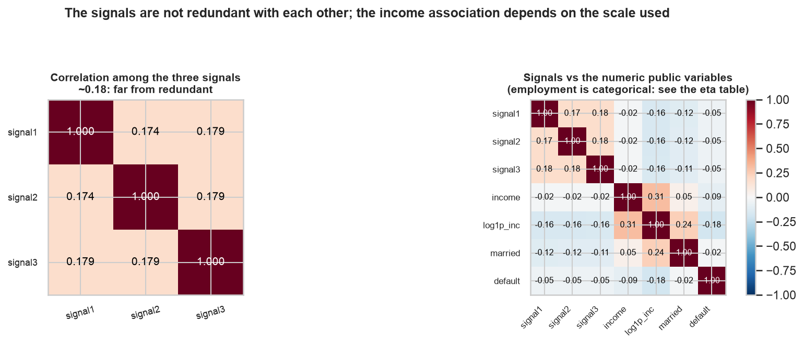

**Reading:** at r ≈ 0.20 one signal explains about **4%** of another's variance, so the three are
nowhere near interchangeable copies of one score. But each one overlaps substantially with
`employment`, which is already available as a public column.

#### The income association depends on which scale is used

Three figures, all real, all computed on the same 100,000 rows:

| measure | `signal1` | `signal2` | `signal3` |
|---|---|---|---|
| Pearson vs raw `income` | −0.0209 | −0.0199 | −0.0171 |
| Spearman vs `income` | −0.0752 | −0.0780 | −0.0746 |
| **Pearson vs `log1p(income)`** | **−0.1585** | **−0.1567** | **−0.1562** |

They disagree because they weight the data differently, and the `log1p` figure is the one that
matters in practice — it is what a model would see if income were log-transformed. Decomposing it:

| | `signal1` | `signal2` | `signal3` |
|---|---|---|---|
| all rows, vs `log1p(income)` | −0.1585 | −0.1567 | −0.1562 |
| the 82,965 rows with `income > 0`, vs `log(income)` | **+0.0610** | **+0.0550** | **+0.0609** |
| vs the `income == 0` flag | +0.1743 | +0.1714 | +0.1719 |

| | mean `signal1` | mean `signal2` | mean `signal3` |
|---|---|---|---|
| `income > 0` | 0.3920 | 0.3905 | 0.3896 |
| `income == 0` | **0.5429** | **0.5387** | **0.5383** |

| employment | % of the `income == 0` block | % of all rows | mean `signal3` |
|---|---|---|---|
| employed | — | 57.9 | 0.4130 |
| retired | — | 11.6 | 0.1331 |
| **student** | **59.7** | **16.2** | **0.6333** |
| unemployed | 40.3 | 14.3 | 0.4036 |

Four things follow:

1. **Among `income > 0` rows the correlation flips sign**, to +0.055…+0.061. The negative headline
   comes entirely from the zero-income block.
2. **That block has a much higher mean signal** (0.5383 for `signal3`) than the `income > 0` rows
   (0.3896) — while `log1p` places all of it at exactly 0, the bottom of the scale. The smallest
   positive income is €6 (`log1p` = 1.95) and the median among `income > 0` is 9.33, so the block
   sits alone at the far left with a gap below everything else. Low x paired with high y.
3. **The block is 59.7% students against 16.2% of all rows**, and students carry the highest mean
   signal of any category (0.6333). Given the population employment mix the block's mean `signal3`
   would be 0.4149; it is actually 0.5383.
4. **Holding employment fixed, zero income makes essentially no difference to the signal**:
   students 0.6311 (`income == 0`) vs 0.6370 (`income > 0`), unemployed 0.4007 vs 0.4062, with
   within-group correlations of +0.0087 and +0.0082.

**Interpretation (ours).** The −0.16 is a **composition effect, not a relationship between income
and the signals.** `log1p` collapses the 17,035 zero-income applicants into one block at the
bottom of the income scale, and that block is disproportionately students, who happen to carry the
highest signals. Point 4 is what rules out the simpler reading: it is not that having no income
raises an applicant's signal — within students and within the unemployed it does not. The
raw-income Pearson of −0.02 hides the same block at the other extreme, because raw income is
dominated by a right tail reaching €1,000,000; Spearman's −0.075 sits in between, since ranks tame
that tail but also compress the gap between zero and low positive incomes.

**Practical note.** This is a second reason not to use `log1p(income)` on its own (the first is in
§6.4): on that scale the zero block masquerades as an extreme income value and drags unrelated
associations along with it. Pairing the log with an `income == 0` flag separates the two, after
which the remaining income–signal association is small and *positive*.

### 7.3 Univariate predictive power

| variable | AUC | note |
|---|---|---|
| `income` | **0.7095** | |
| `log1p(income)` | 0.7095 | identical by construction |
| `income == 0` flag | **0.5974** | binary |
| `employment` | 0.5790 | scored by group default rate |
| **`signal3` (ours)** | **0.5446** | zeros kept as 0 |
| `signal1` (lender 1) | 0.5429 | zeros kept as 0 |
| `signal2` (lender 2) | 0.5425 | zeros kept as 0 |
| `married` | 0.5184 | scored by group default rate |
| `sex` | 0.5172 | scored by group default rate |
| `signal3 == 0` flag | 0.5033 | binary — essentially uninformative about risk |

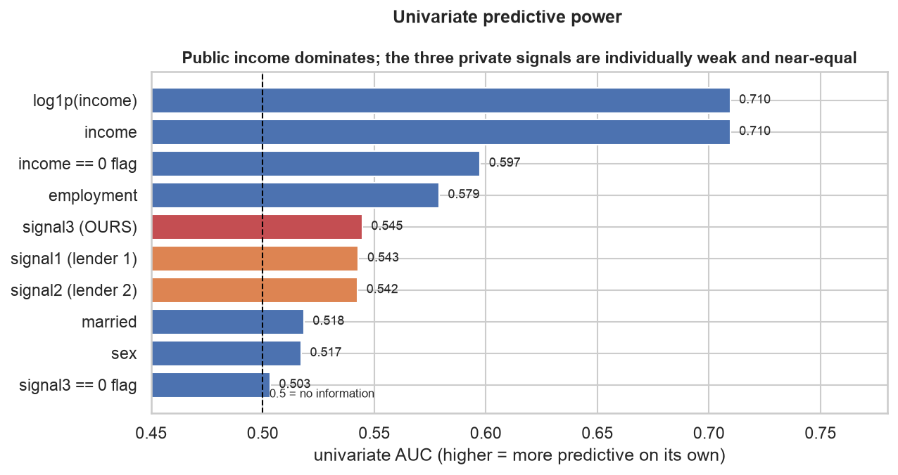

---

## 8. Interactions

Descriptive looks only; no models fitted.

### 8.1 `signal3 × employment`

| employment | n | base rate | s1 (lowest positive quintile) | s5 (highest) | drop | s1/s5 ratio | AUC within |
|---|---|---|---|---|---|---|---|
| employed | 57,936 | 7.93% | 12.62% | 5.11% | 7.51 pp | 2.47 | 0.5697 |
| retired | 11,582 | 8.95% | 15.57% | 5.78% | 9.79 pp | 2.69 | 0.5485 |
| student | 16,183 | 12.85% | 18.97% | 9.96% | 9.02 pp | 1.91 | 0.5724 |
| unemployed | 14,299 | 15.62% | 24.51% | 10.39% | 14.12 pp | 2.36 | 0.5527 |

`signal3` separates risk inside **every** employment category, so its effect is not an artefact of
employment mix. The absolute gap scales with the group's base rate, but the **ratio** is far more
stable (1.9–2.7), and dividing each curve by its group's base rate makes them nearly coincide.

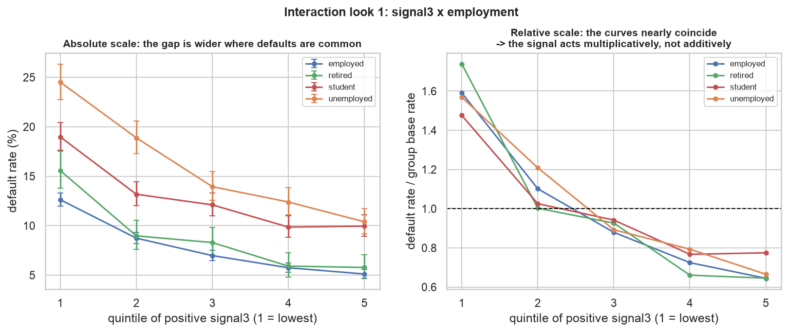

**Reading:** dividing each curve by its group's base rate makes the four nearly coincide, so the
signal shifts risk by roughly a constant **factor** rather than a constant number of percentage
points. On that reading an explicit `signal × employment` term has little left to capture —
suggestive rather than conclusive.

### 8.2 Other interactions checked

- **`signal3 × (income == 0)`:** both slope down; within-group AUC 0.5854 (income 0) vs 0.5678
  (income > 0), s1/s5 ratios 2.34 and 2.52. Similar shape, different level.
- **`income × employment`:** all four categories slope down from different levels; within-group
  AUC 0.7111 employed, 0.6808 retired, 0.7378 student, 0.7383 unemployed.
- **`sex × married`:** F single 11.41%, F married 10.19%, M single 10.32%, M married 8.83%. The
  marriage gap is +1.22 pp for women and +1.49 pp for men — parallel, so no clear interaction.

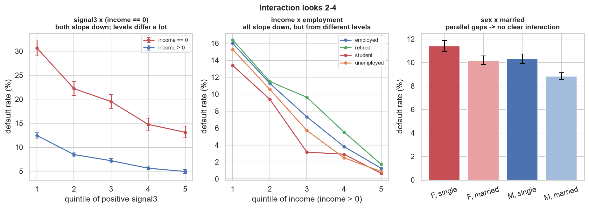

**Only `employment × income==0` (6.2) looks like a real interaction**, and even there the open
question is whether it adds anything beyond the two main-effect features.

---

## 9. Are the new applicants the same population?

Every model is fitted on `PastLoans` and applied to the new file, so this matters.

**Caveat on the p-values:** with 100,000 rows per file these tests have ample power to flag
differences far too small to matter in practice, so a rejection would not by itself be alarming.
As it turns out none of them rejects.

| variable | level | past % | new % | diff | z | p |
|---|---|---|---|---|---|---|
| `sex` | F | 42.67 | 42.83 | +0.16 | 0.74 | 0.461 |
| `employment` | employed | 57.94 | 57.82 | −0.11 | −0.50 | 0.615 |
| | retired | 11.58 | 11.59 | +0.01 | 0.04 | 0.967 |
| | student | 16.18 | 16.05 | −0.13 | −0.81 | 0.419 |
| | unemployed | 14.30 | 14.54 | +0.24 | 1.52 | 0.130 |
| `married` | 1 | 60.82 | 61.10 | +0.27 | 1.26 | 0.209 |

χ² on the full employment distribution: 2.62 on 3 df, p = 0.454.

| variable | KS statistic | p | interpretation |
|---|---|---|---|
| `income` | 0.00265 | 0.873 | the two CDFs never differ by more than 0.27 pp |
| `signal3` | 0.00360 | 0.535 | never differ by more than 0.36 pp |

Income quantiles differ by €22–32 through the middle of the distribution; `signal3` quantiles by
at most 0.0055. The special features line up too: income-zero share 17.04% vs 17.16%, top-code
share 0.071% vs 0.082%, `signal3`-zero share 21.06% vs 20.94%.

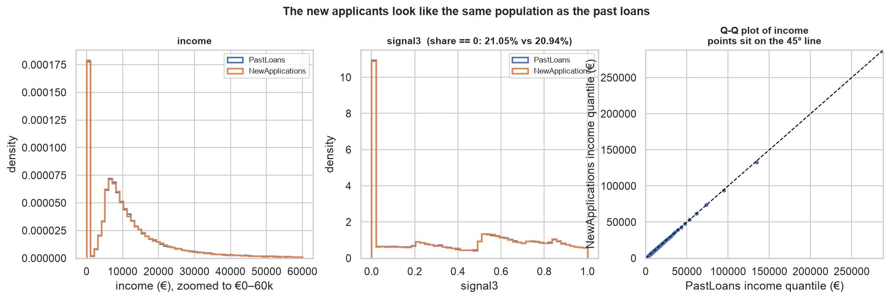

**Reading:** consistent with the brief's claim of a common population. Note this checks the
**distribution of inputs** only. We cannot verify that the default *mechanism* is unchanged,
because the new file has no outcomes — that part has to be taken on trust.

---

## 10. Recommendations

Each is a **recommendation with its evidence and its caveats**.

### 10.1 Log-transform income — recommended
**Evidence:** raw skew 11.94; linear fit to the bin log-odds improves from R² 0.713 to 0.965.
**Caveat:** AUC is unchanged (0.7095 either way), so this is about functional form, not
information — it matters for linear models but not for tree-based ones, which are invariant to
monotone transforms. Use `log1p`, or `log` on the positive part, **paired with 10.2**: `log1p`
alone represents the zeros badly, dumping 17,035 rows at exactly 0.

### 10.2 Add an `income == 0` flag — strongly recommended
**Evidence:** 17.0% of rows; 20.19% vs 7.84% default; survives within students (+11.06 pp, z=23)
and within the unemployed (+18.00 pp, z=30); worse than the lowest positive income quartile of the
same employment group; AUC 0.5974 standalone, second only to income itself.
**Caveat:** none material. Cheapest large gain available.

### 10.3 Do not feed the signal zeros in as the number `0` — recommended, coding left open
**Evidence:** section 5, four consistent checks; and on identical rows, recoding the zeros to a
neutral value is worth +0.021 to +0.024 AUC with bootstrap intervals excluding zero.
Options worth comparing on validation data:
1. a `signal_missing` indicator column plus the signal imputed to a neutral value,
2. imputation alone,
3. leaving the `0` in place for a tree model to split off by itself,
4. a binned/categorical signal with "missing" as its own level.

The AUC table measures the cost of the worst option, not the gain from the best, so it ranks
nothing beyond ruling out the bare literal `0`. Whatever is chosen must be applied **identically**
to the new applications, where `signal3` is 0 for 20.94% of applicants.

### 10.4 One-hot encode employment, not ordinal — recommended
**Evidence:** the risk ordering reverses between all applicants and `income > 0` applicants (rank
correlation −0.60, full detail in §6.2), so no stable ranking exists for an ordinal code to
represent. With four levels one-hot costs three columns.
**Open question, not a recommendation:** does an explicit `employment × income==0` interaction add
anything **beyond** one-hot employment plus the flag from 10.2? Income-zero occurs in only two of
the four categories, so the two main-effect features may already span the pattern.

### 10.5 Income top-code flag — recommended against, on current evidence
**Evidence:** 71 rows at the cap (0.071%), **all 71 repaid**. A flag on 71 rows with zero defaults
is perfectly separating on a very thin slice of the data. With n = 71 the 95% CI on their default
rate still reaches **5.13%** — half the population rate — so "these never default" is not
established by the data. The log transform already places them at the top of the scale.
**Alternative:** a broader `income ≥ €100k` flag (2,284 rows, 2 defaults) is
less degenerate, though still close to separating.

### 10.6 Other interactions — low priority
**Evidence:** `signal3 × employment` curves nearly coincide once each is divided by its group's
base rate (s1/s5 ratios 1.91–2.69, within-group AUC 0.549–0.572), so the signal shifts risk by
roughly a constant factor rather than a constant number of percentage points. `sex × married`
gaps are parallel.

### 10.7 Do not de-duplicate — recommended
**Evidence:** all duplicates sit in the all-signals-zero subset, where 1,258 rows occupy only 1,185
distinct public profiles, making collisions unavoidable; zero duplicates among rows with any
positive signal. Full reconciliation of the 1,258 / 73 / 68 / 79 counts is in section 2.2. Dropping
them would discard real borrowers and bias the sample towards profiles that happen not to collide.

---

## 11. Open questions

1. **What does `signal = 0` actually mean?** Our evidence strongly indicates "no signal received",
   but the brief does not say, and the answer determines how the signals should be encoded.
2. **Does an explicit `employment × income==0` interaction beat one-hot employment plus an
   income-zero flag?** (10.4)
3. **Does the near-separation above €125,000 generalise**, or is it a small-sample artefact?
4. **Are the duplicate rows acceptable to keep?** We keep them (10.7).
5. **Is the default mechanism really unchanged** in the new file? Unverifiable without outcomes
   (section 9); taken on trust from the brief.

---

## 12. Reproducing this analysis

```bash
uv venv --python 3.12
uv pip install -r requirements.txt
cd analysis && jupyter nbconvert --to notebook --execute --inplace eda.ipynb
```

Environment: Python 3.12, pandas 3.0.6, numpy 2.5.4, scikit-learn 1.9.1, seaborn 0.13.2, scipy.
File paths, the €1M top-code constant and the random seed (42) are read from `src/config.py`.
