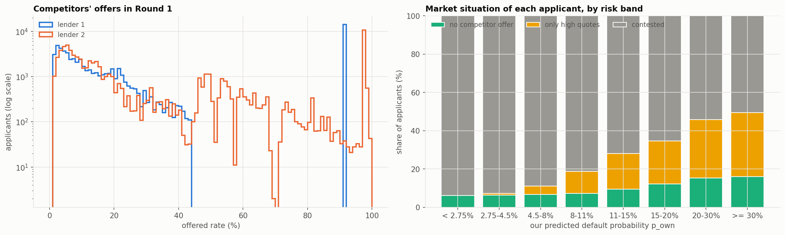
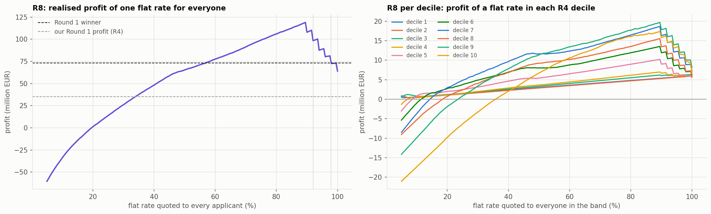
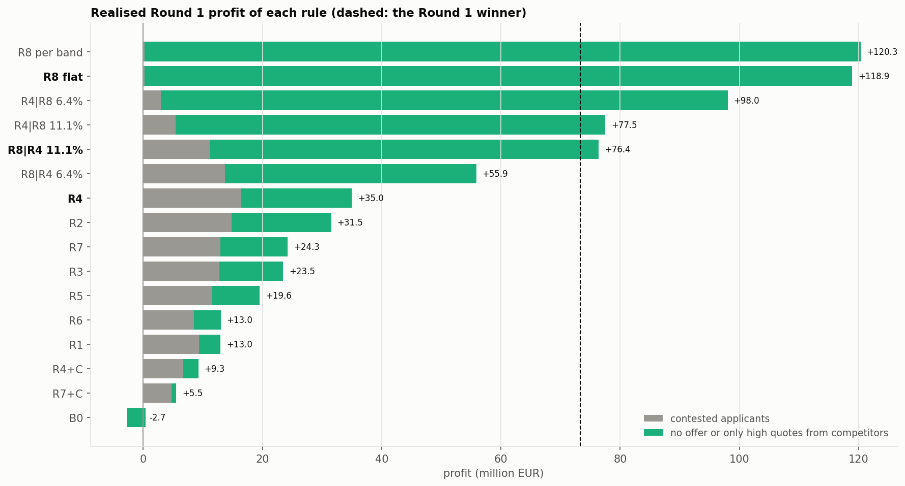
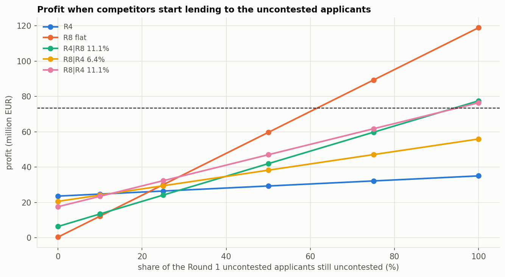

# Lending Game — Part 9: Replaying the candidate rules on the real Round 1 market

What our rules would have earned in Round 1, and what that implies for Round 2. Everything comes from
`analysis/round1_replay.ipynb`; the code is in `src/round_1_replay.py`.

In Round 1 we submitted rule **R4** (Part 7) and made **€35.0M with a 55.6% market share, 4th of 12
teams**. The winner made **€73.3M**. The course's diagnostic file (`data/raw/Round1_Diagnostic_31.csv`)
gives, for each of the 100,000 applicants, **the two competitors' actual offers, the borrower's
preference type and the observed default**. Replacing our offer and rerunning the Part 4 simulator
therefore gives the **exact** profit any rule would have made: a counterfactual, not a scenario.

## Summary

- **The replay is exact:** our submitted R4 offers reproduce the course's outcome for 100% of
  applicants and our profit to the euro (€35,004,136).
- **R4 was the best of the ten Part 6 rules on the real market.** Quoting risky applicants high
  instead of refusing them (R4 vs R4+C) was worth **+€25.7M**, as Part 7 bet.
- **But the real market was not in any of our scenarios.** **20% of applicants were uncontested**:
  8.8% got no competitor offer and 11.5% got only fixed high quotes (91.99% or 97.89%). They accept
  our offer at any rate up to 100%.
- **A single rate of 89.5% for everyone (R8) would have made €118.9M**, 3.4 times our profit and 1.6
  times the winner's. Cross-fitting gives the same number, so this is not noise.
- **Our model was not the problem.** $p_{own}$ was calibrated on all applicants (9.96% predicted,
  9.95% observed). The +0.95-point gap on our loans is the winner's curse. Luck of the borrower types
  was worth €36k.
- **Market share was the wrong target:** R4 had 55.6% of the market at €630 per loan; R8 would have
  had 20% at €5,850 per loan.
- **For Round 2, the robust hybrid is R8|R4** (a high quote on safe applicants, R4 on risky ones). It
  beats R4 if at least 13% of the uncontested pool survives, and loses at most €6M if the pool
  disappears entirely. The reverse hybrid R4|R8, suggested in the plan, collapses when the pool shrinks.

---

## 1. Checking the replay

Our submitted offers (rule R4, rebuilt with `load_tuned_rules`) are replayed against the real
competitor offers with each borrower's real preference type:

| check | result |
|---|---|
| acceptances matching the course's | 100.00% |
| replayed profit | €35,004,136 |
| reported profit | €35,004,136 |
| largest per-loan difference | €0.0005 (rounding of the rates in the file) |

Every number below is what a rule **would** have earned in Round 1.

## 2. What the competitors actually did

Each competitor slot is a mixture of four teams, drawn at random per loan. The offers show three
behaviours:

| | lender 1 | lender 2 |
|---|---|---|
| no offer | **34.4%** | **25.2%** |
| most frequent rate | **91.99%** (14.2% of applicants) | **97.89%** (10.5%) |
| median offer | 12.8% | 14.4% |

- **No offer.** Flat at 25% across risk bands for lender 2. For lender 1 it rises with risk, from
  25% for the safest applicants to 62% for $p_{own} \ge 30\%$.
- **A fixed high quote**, the same for every applicant whatever the risk: one team quoting one very
  high rate.
- **A real pricing curve** for the rest.

**Market situation of each applicant, from our point of view** (a "high quote" is an offer of 90% or
more):

| $p_{own}$ band | applicants | no competitor offer | only high quotes | contested | default rate |
|---|---|---|---|---|---|
| < 2.75% | 19,615 | 6.3% | 0.0% | 93.7% | 1.4% |
| 2.75–4.5% | 10,482 | 6.5% | 0.9% | 92.6% | 3.6% |
| 4.5–8% | 17,036 | 6.8% | 4.4% | 88.8% | 6.8% |
| 8–11% | 12,625 | 7.4% | 11.4% | 81.2% | 9.4% |
| 11–15% | 18,745 | 9.5% | 18.6% | 71.9% | 13.2% |
| 15–20% | 10,519 | 12.2% | 22.5% | 65.3% | 17.3% |
| 20–30% | 9,158 | 15.3% | 30.6% | 54.1% | 23.1% |
| ≥ 30% | 1,820 | 16.2% | 33.2% | 50.6% | 30.8% |
| **all** | **100,000** | **8.8%** (8,754) | **11.5%** (11,541) | **79.7%** (79,705) | 9.95% |

**The uncontested share rises with risk**, from 6% of the safest applicants to about half of those
above 20%. Even the safest band has 1,229 uncontested borrowers, with a 1.4% default rate.

**Our Part 7 scenarios missed this.** None had fixed high quotes; only S_R4C (competitors using our
cutoff rule) had a large uncontested pool, and it was the scenario that made R4 the choice.

**Are the uncontested borrowers riskier than we think?** A little:

| situation | applicants | mean $p_{own}$ | default rate | gap |
|---|---|---|---|---|
| contested | 79,705 | 8.67% | 8.32% | −0.35 pt |
| no competitor offer | 8,754 | 12.53% | 13.58% | **+1.05 pts** |
| only high quotes | 11,541 | 16.86% | 18.46% | **+1.60 pts** |

The competitors' refusals carry some information we lack (their own signals). But at a 90% rate a
repaying borrower earns €9,000 and a default costs €10,000, so a 1.6-point surprise costs about €300
per loan, against a margin of several thousand euros.

## 3. The Part 6 rules on the real market

| rule | profit | loans | share | profit per loan | avg rate | default rate of loans won | gap |
|---|---|---|---|---|---|---|---|
| **R4 (submitted)** | **€35.0M** | 55,568 | 55.6% | €630 | 21.5% | 11.4% | +0.95 pt |
| R2 | €31.5M | 52,616 | 52.6% | €599 | 21.4% | 11.6% | +1.13 pts |
| R7 | €24.3M | 57,905 | 57.9% | €419 | 19.4% | 11.8% | +1.09 pts |
| R3 | €23.5M | 56,910 | 56.9% | €413 | 19.5% | 11.9% | +1.10 pts |
| R5 | €19.6M | 52,596 | 52.6% | €372 | 20.7% | 13.3% | +1.01 pts |
| R6 | €13.0M | 51,668 | 51.7% | €252 | 19.7% | 13.7% | +0.86 pt |
| R1 | €13.0M | 53,449 | 53.4% | €243 | 19.4% | 13.6% | +0.93 pt |
| R4+C | €9.3M | 35,808 | 35.8% | €259 | 9.9% | 6.4% | +0.73 pt |
| R7+C | €5.5M | 29,177 | 29.2% | €190 | 7.8% | 5.4% | +0.77 pt |
| B0 | −€2.7M | 80,482 | 80.5% | −€33 | 12.4% | 10.7% | +0.40 pt |

- **Part 7's choice was right among the candidates, for the reason Part 7 gave.** R4 and R4+C differ
  only on the riskiest third of applicants; quoting them high rather than refusing them was worth
  **€25.7M**. The competitors did stay away from them.
- **Break-even pricing (B0) loses €2.7M**: the winner's curse is real.
- **More than half of R4's profit came from one fifth of the applicants:**

  | | contested | no competitor offer | only high quotes |
  |---|---|---|---|
  | applicants | 79,705 | 8,754 | 11,541 |
  | R4 profit | €16.4M | €6.7M | €11.8M |

  The cutoff rules gave up most of the uncontested pool, which is why they finish last among the
  rules that make money.
- **Luck was negligible.** Averaging over the three preference types instead of using the real ones
  moves R4's profit by −€36k (0.1%), and the other rules by at most ±€0.4M.

### Calibration and the winner's curse

| $p_{own}$ band | gap on all applicants | loans R4 won | gap on loans won |
|---|---|---|---|
| < 2.75% | +0.07 pt | 9,727 | +0.35 pt |
| 2.75–4.5% | +0.00 pt | 5,715 | +0.22 pt |
| 4.5–8% | +0.59 pt | 9,411 | +1.31 pts |
| 8–11% | −0.06 pt | 7,922 | +0.64 pt |
| 11–15% | +0.19 pt | 9,567 | **+1.91 pts** |
| 15–20% | −0.05 pt | 5,955 | +1.41 pts |
| 20–30% | −0.72 pt | 6,279 | +0.99 pt |
| ≥ 30% | −4.37 pts | 992 | −2.03 pts |

(gap = observed default rate − mean $p_{own}$)

- **On all applicants, the model is calibrated** within about 0.7 point in every band, except above
  30%, where it *over*-predicts by 4.4 points (1,820 applicants).
- **On the loans we won, defaults run 1–2 points above prediction between 11% and 30%.** The
  "under-prediction above 11%" noted after Round 1 is **selection, not miscalibration**: the
  competitors priced away the better borrowers of those bands. Retraining on 200k loans will not remove
  it; a margin has to pay for it.

## 4. What R4 left on the table in the contested market

On the 79,705 contested applicants, the best flat margin per R4 decile, chosen in hindsight:

| decile ($p_{own}$ from) | R4 margin | best margin | R4 profit | best profit |
|---|---|---|---|---|
| 1 (0%) | 1.75 pts | 2.75 pts | €0.48M | €0.75M |
| 2 (1.2%) | 1.75 pts | 2.5 pts | €0.69M | €0.87M |
| 3 (2.8%) | 2 pts | 3.5 pts | €0.91M | €1.13M |
| 4 (4.5%) | 3.2 pts | 4.75 pts | €0.66M | €0.74M |
| 5 (6.4%) | 3.2 pts | 5 pts | €1.25M | €1.33M |
| 6 (8.7%) | 3.2 pts | 32 pts | €1.27M | €2.31M |
| 7 (11.1%) | 16.9 pts | 31.5 pts | €2.99M | €3.96M |
| 8 (13.3%) | 16.9 pts | 30.5 pts | €2.11M | €2.74M |
| 9 (15.4%) | 19.4 pts | 27 pts | €3.11M | €3.70M |
| 10 (20.6%) | 19.4 pts | 25.5 pts | €2.98M | €3.26M |
| **total** | | | **€16.4M** | **€20.8M** |

- **R4's margins were too low everywhere.** On safe applicants (below 8.7%), 2.5–5 points would have
  paid more than 1.75–3.2 (+€0.8M).
- **Above 8.7%, margins of 25–32 points paid even on contested applicants** (+€3.5M): a contested
  applicant can still have a competitor offer between 40% and 90%.
- **Even with perfect hindsight, the contested market was worth only about €21M.** The money was
  elsewhere.

## 5. R8: a high quote

**R8** quotes one flat rate to every applicant (no offer when $p_{own} \ge 50\%$).

| flat rate | 50% | 70% | 80% | 85% | 89% | **89.5%** | 90% | 92% | 95% | 98% | 100% |
|---|---|---|---|---|---|---|---|---|---|---|---|
| profit | €65.3M | €91.3M | €105.9M | €112.5M | €118.2M | **€118.9M** | €107.9M | €98.3M | €88.7M | €72.4M | €64.1M |

- **Why 89.5%:** it is just under 91.99% − 2 points. A borrower who prefers lender 1 sees its 91.99%
  quote as 89.99%, so 89.5% still wins. At 90.0% that borrower goes back to lender 1.
- **Profit falls in steps above 89.5%**, as each high-quote team wins its applicants back. At 100% we
  win only the applicants with no competitor offer, and that alone is **€64M**, as much as the winner.
- **R8 wins almost nothing contested** (€0.2M). All its profit comes from the uncontested 20%.

**One rate per decile adds little** (€120.3M): the three safest deciles prefer 99.5–100%, since almost
none of them get only high quotes, and every other decile picks 89.5%.

**Cross-fitting** (rate chosen on one half of the applicants, scored on the other, then swapped):

| | in sample | cross-fitted |
|---|---|---|
| R8, one flat rate | €118.9M | €118.9M (both halves pick 89.5%) |
| R8, one rate per decile | €120.3M | €120.1M |

The result is driven by the **structure** of the Round 1 market (the uncontested pool and the exact
level of the high quotes), not by noise in the defaults.

## 6. R4/R8 hybrids

Two directions, with one switch point at an R4 decile edge and the 89.5% high quote:

- **R4|R8**: R4 below the switch, the high quote above (the plan's "compete on the safe, quote high on
  the risky");
- **R8|R4**: the high quote below the switch, R4 above.

**In hindsight, more high quote is always better in both directions**: in every decile the 89.5% quote
earns more than R4, so the pure R8 is best. The two hybrids differ in *what* they give up:

| rule | profit | loans | share | profit per loan | no competitor offer | only high quotes | contested |
|---|---|---|---|---|---|---|---|
| R8 per band | **€120.3M** | 20,243 | 20.2% | €5,943 | €57.7M | €62.4M | €0.2M |
| R8 flat (89.5%) | €118.9M | 20,328 | 20.3% | €5,850 | €55.8M | €62.9M | €0.2M |
| R4\|R8 6.4% | €98.0M | 38,048 | 38.0% | €2,577 | €34.8M | €60.3M | €3.0M |
| R4\|R8 11.1% | €77.5M | 46,918 | 46.9% | €1,652 | €24.9M | €47.2M | €5.5M |
| R8\|R4 11.1% | €76.4M | 28,978 | 29.0% | €2,637 | €37.7M | €27.5M | €11.2M |
| R8\|R4 6.4% | €55.9M | 37,848 | 37.8% | €1,477 | €27.7M | €14.5M | €13.7M |
| **R4 (submitted)** | **€35.0M** | 55,568 | 55.6% | €630 | €6.7M | €11.8M | €16.4M |
| *Round 1 winner* | *€73.3M* | | | | | | |
| *perfect foresight (oracle)* | *€282.2M* | 88,675 | 88.7% | €3,182 | | | |

- **R4|R8 gives up the safe uncontested applicants** (R4 quotes them 3–6%, while 89.5% earns close to
  €9,000 each) **and most of R4's contested profit**, which sits in the risky bands.
- **R8|R4 keeps two thirds of R4's contested profit** and still collects €65M from the uncontested pool.
- **Every high-quote rule except R8|R4 6.4% beats the winner.** The winner probably exploited part of
  the uncontested pool.
- The **oracle** knows every default and competitor offer; it bounds what is possible but is not
  attainable.

## 7. Would it survive Round 2?

Every team now has its diagnostic file and can see the uncontested pool. Two stress tests:

**Stress 1: the uncontested pool shrinks.** In each band, only a share $s$ of the uncontested
applicants stays uncontested; the others earn what the rule earned per contested applicant of that
band in Round 1.

| rule | $s = 0$ | $s = 25\%$ | $s = 50\%$ | $s = 100\%$ (Round 1) | beats R4 if $s \ge$ |
|---|---|---|---|---|---|
| R4 | **€23.6M** | €26.4M | €29.3M | €35.0M | — |
| R8 flat | €0.4M | €30.0M | **€59.6M** | **€118.9M** | 22% |
| R4\|R8 6.4% | €3.3M | €27.0M | €50.7M | €98.0M | 24% |
| R4\|R8 11.1% | €6.4M | €24.1M | €41.9M | €77.5M | 29% |
| R8\|R4 6.4% | €20.6M | €29.4M | €38.2M | €55.9M | **12%** |
| R8\|R4 11.1% | €17.6M | **€32.3M** | €47.0M | €76.4M | 13% |

- **R8 flat is all or nothing:** it earns nothing if the pool disappears.
- **R8|R4 needs only 12–13% of the pool to beat R4**, is the best rule at $s = 25\%$, and loses only
  €3–6M against R4 if the pool disappears entirely.
- **R4|R8 is the worst choice when the pool shrinks** (€3–6M at $s = 0$).
- **Per band, the high quote needs the least help on safe applicants:** R8 beats R4 with 11–16%
  survival below 11% risk, against 23–53% above. There R4's contested margin is thin, while a safe
  uncontested borrower at 89.5% earns €8,000–8,800 in expectation. This is why R8|R4 is the robust
  direction.

**Stress 2: the high-quote teams cut their quote.** Every competitor quote of 90% or more is replaced
by $q$; no-offers are unchanged and our rates stay as they are.

| rule | Round 1 | $q$ = 92% | 90% | 88% | 85% | 80% |
|---|---|---|---|---|---|---|
| R4 | €35.0M | €34.9M | €34.9M | €34.9M | €34.9M | €34.8M |
| R8 flat | €118.9M | €119.0M | €92.8M | €77.1M | €56.0M | €56.0M |
| R4\|R8 11.1% | €77.5M | €77.5M | €57.5M | €46.1M | €30.3M | €30.3M |
| R8\|R4 6.4% | €55.9M | €55.8M | €54.9M | €54.1M | €53.3M | €53.3M |
| R8\|R4 11.1% | €76.4M | €76.3M | €70.2M | €66.0M | **€60.6M** | **€60.5M** |

- **Down to 92%, nothing changes:** our 89.5% still wins.
- **At 85% and below, R8 keeps only the no-offer applicants (€56M)**, still 1.6 times R4.
- **R8|R4 11.1% loses the least** and becomes the best rule at 85%.
- This keeps our quote at 89.5%. In Round 2 the high quote is itself a price war: on an applicant with
  only high quotes, the lowest effective quote wins, and the 2-point preference of our type-3 borrowers
  helps us.

## 8. Conclusions

**What happened in Round 1**

1. **R4 was the right choice among the rules we had**, and its high quotes on risky applicants were
   the right bet (+€25.7M over the cutoff).
2. **Our candidate set missed the real market.** One applicant in five was uncontested, and we priced
   them as if they were contested. **R4 left about €84M on the table against a flat 89.5% quote**,
   almost all of it in that pool; better contested margins would have added only about €4M.
3. **Model quality, calibration and luck were not the problem.** The extra defaults on our loans are
   the winner's curse, and the uncontested applicants are only 1–1.6 points riskier than predicted,
   which is irrelevant at a 90% rate.
4. **Market share was the wrong target.** Profit per loan matters: €630 for R4 against €5,850 for R8.

**What it means for Round 2 (Parts 10–12)**

5. **Everything depends on how much of the uncontested pool survives**, and every team now knows it
   exists. Part 10 should measure the pool by competitor behaviour (no offer, high quote, pricing
   curve) and by risk band, and build the empirical scenario from it.
6. **Use the R8|R4 direction, not R4|R8:** a high quote on safe applicants, R4 (with better margins)
   on risky ones. It beats R4 as soon as 13% of the pool survives, loses at most €6M if the pool
   disappears, and loses the least when the high quotes are undercut.
7. **The level of the high quote is the key parameter, and it is strategic.** 89.5% was tuned to one
   team's 91.99%. Part 11 must re-tune it against competitors who undercut (85–90%).
8. **Raise the contested margins** in Part 11: 2.5–5 points below 8.7% risk, and much higher (25–32
   points) above, where R4 used 3.2–19.4 (+€4.3M in hindsight).
9. **Retraining on 200k loans is a low priority:** the under-prediction above 11% on our loans comes
   from selection, not from the model.

## 9. Limitations

- **Hindsight.** R8's rate and the hybrids' switch points are tuned on the market they are scored on.
  Cross-fitting shows this is not overfitting the *defaults*, but it cannot protect against the
  *competitors* changing: Round 2 teams have seen the same diagnostic.
- **The stress tests are simple.** Stress 1 assumes newly contested applicants earn each rule's Round 1
  contested profit per applicant in that band; Stress 2 keeps our quote fixed at 89.5% and changes only
  the high quotes. Neither models other teams also quoting just below 90%.
- **Each competitor slot is a mixture of teams**, so the Round 1 offers describe the mixture, not any
  one team's rule (Part 10).

## 10. Deliverables

| file | content |
|---|---|
| `src/round_1_replay.py` | loading the diagnostic, replay, R8 and hybrid rules, hindsight tuning, stress tests, plots |
| `analysis/round1_replay.ipynb` | the analysis behind this report |
| `report/figures/fig18_round1_market.png` | competitors' offers and market situation by risk band |
| `report/figures/fig19_round1_high_quote.png` | R8 profit by flat rate, overall and per decile |
| `report/figures/fig20_round1_rule_profits.png` | realised Round 1 profit of every rule |
| `report/figures/fig21_round1_stress.png` | profit as the uncontested pool shrinks |
