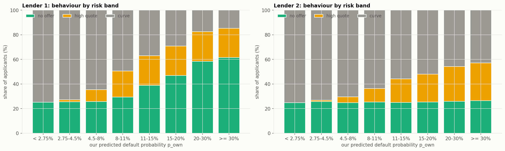
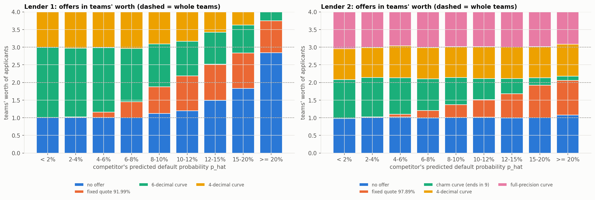
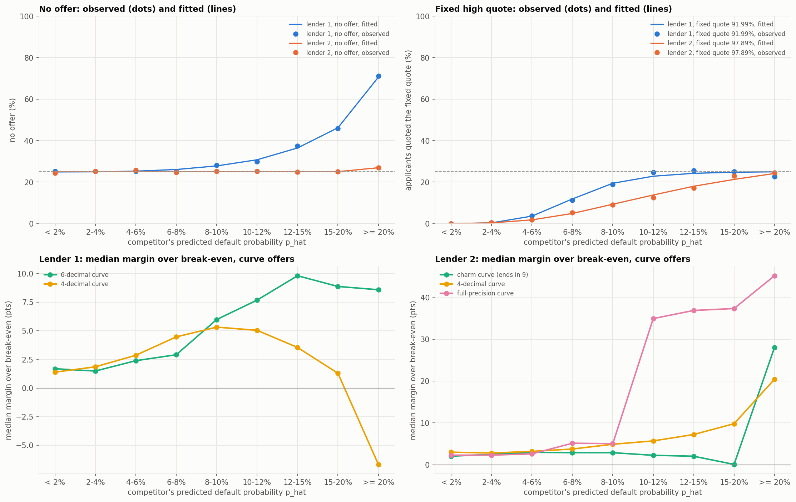
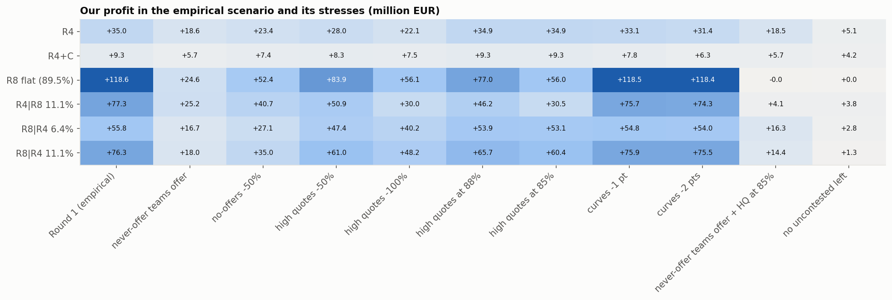

# Lending Game — Part 10: Inferring the competitors' rules from Round 1

Who the competitors were, which rules produced the Round 1 market, and an empirical scenario to test
our Round 2 rule against. Everything comes from `analysis/round_1_competitors_rules.ipynb`; the code
is in `src/round_1_competitors_rules.py`.

**How the market is built** (course results, section A): for each loan, competitor slot 1 is one of
the **four type-1 teams** and slot 2 one of the **four type-2 teams** (three student teams and one LLM
team per type), each drawn at random. So `competing1` is not one lender but a **mixture of four
rules**, each applied to about a quarter of the applicants, and likewise for `competing2`.

**The competitors' default probability is never observed** (we do not see `signal1` or `signal2`).
$\hat p_1$ and $\hat p_2$ are its forecast from our own information (Part 6's competitor model, as
for rule R7). Every threshold below is on that forecast, so it is blurred by the competitor's unseen
signal.

## Summary

- **Each slot splits into four teams**, identified by fingerprints in the offers: the number of
  decimals each team rounded to, a fixed high quote, and "charm" rates ending in 9.
- **One team in each slot never made an offer** (25% of applicants, whatever the risk). Together
  they leave **1/16 = 6.25% of applicants with no competitor offer**, which is exactly the
  uncontested share among the safest applicants.
- **One team in each slot quotes a fixed high rate to risky applicants:** 91.99% from
  $\hat p \approx 7\%$ (lender 1) and 97.89% from $\hat p \approx 10\%$ (lender 2). Lender 1 also has
  **two cutoff teams** that stop lending to risky applicants.
- **Every curve team prices safe applicants 1.4–3 points over break-even**, like our R4. Their
  margins diverge above 10% risk, from 5 points to a 35–45-point step.
- **The empirical scenario reproduces Round 1:** competitor offers resampled within (risk bin ×
  default) give every rule's real profit back within €0.2M.
- **The high-quote strategy rests mostly on the two never-offer teams.** If they start offering, R8
  falls from €119M to €25M and R8|R4 from €76M to €18M, below R4 (€19M).
- **This reverses Part 9's choice of hybrid:** R4|R8 (a high quote on risky applicants only) is the
  best rule in that case (€25M) and stays strong otherwise (€77M).

---

## 1. Three behaviours

Each offer is a **no offer**, a **high quote** (90% or more, as in Part 9) or a **curve** offer (a rate
that depends on risk).

| | no offer | high quote | curve |
|---|---|---|---|
| lender 1 | 34.4% | 14.2% | 51.4% |
| lender 2 | 25.2% | 11.5% | 63.3% |

| $p_{own}$ band | L1 no offer | L1 high quote | L1 curve | L2 no offer | L2 high quote | L2 curve |
|---|---|---|---|---|---|---|
| < 2.75% | 25.1% | 0.1% | 74.8% | 24.8% | 0.1% | 75.1% |
| 2.75–4.5% | 25.5% | 1.7% | 72.8% | 25.7% | 1.2% | 73.1% |
| 4.5–8% | 25.7% | 9.8% | 64.5% | 24.8% | 4.8% | 70.4% |
| 8–11% | 29.4% | 21.1% | 49.5% | 25.4% | 11.0% | 63.6% |
| 11–15% | 38.9% | 24.2% | 37.0% | 25.0% | 19.2% | 55.8% |
| 15–20% | 46.8% | 24.1% | 29.1% | 25.3% | 22.7% | 52.0% |
| 20–30% | 58.5% | 24.1% | 17.4% | 25.9% | 28.4% | 45.7% |
| ≥ 30% | 61.6% | 23.6% | 14.8% | 26.5% | 30.7% | 42.8% |

- **No offer:** flat at 25% for lender 2. For lender 1, 25% for the safest applicants, rising to 62%.
- **High quote:** almost none below 4.5% risk. It plateaus at 24% for lender 1 (from 11% risk) and
  reaches 31% for lender 2.
- **25% is exactly one team out of four.** Section 2 checks whether each behaviour is one team's.

## 2. Telling the four teams apart

The guidelines suggest clustering on the margin. The offers carry sharper fingerprints:

- **Decimals.** The course file stores rates as float32, so `0.0559` is read back as `0.055900000`.
  The number of decimals a team submitted is the fewest decimals that give the same float32.
  - Lender 1's offers have **at most 4** or **5–6 decimals**.
  - Lender 2's offers have **at most 4** or **5–9** (mostly 7–9: a team that does not round).
- **Fixed quotes:** 91.99% (lender 1, 14,214 offers) and 97.89% (lender 2, 10,527 offers).
- **Charm pricing:** among lender 2's 4-decimal offers, **17,352 end in 9**, against about 2,400 for
  each other digit (0.0199, 0.0249, …). 97.89% ends in 9 too: the charm team is the high-quote team.
  About 14% of the offers ending in 9 come from the other 4-decimal team by chance.

**Counting in teams' worth.** In a risk band of $n$ applicants, each team is drawn for about $n/4$.
Dividing each fingerprint group's count by $n/4$ gives how many teams it represents; each row sums
to 4. A group at 1.00 in every band is one team that always behaves that way.

**Lender 1** (bands of $\hat p_1$):

| $\hat p_1$ | no offer | fixed 91.99% | 6-decimal curve | 4-decimal curve |
|---|---|---|---|---|
| < 2% | 1.01 | 0.00 | 1.98 | 1.00 |
| 4–6% | 1.01 | 0.15 | 1.83 | 1.01 |
| 6–8% | 1.00 | 0.46 | 1.51 | 1.03 |
| 8–10% | 1.12 | 0.75 | 1.22 | 0.91 |
| 10–12% | 1.20 | 0.99 | 0.98 | 0.83 |
| 12–15% | 1.49 | 1.03 | 0.90 | 0.58 |
| 15–20% | 1.83 | 1.00 | 0.79 | 0.37 |
| ≥ 20% | 2.84 | 0.90 | 0.25 | 0.00 |

**Lender 2** (bands of $\hat p_2$):

| $\hat p_2$ | no offer | fixed 97.89% | charm curve | 4-decimal curve | full-precision curve |
|---|---|---|---|---|---|
| < 2% | 0.98 | 0.00 | 1.10 | 0.88 | 1.04 |
| 4–6% | 1.03 | 0.07 | 1.03 | 0.91 | 0.96 |
| 8–10% | 1.01 | 0.36 | 0.77 | 0.87 | 0.98 |
| 10–12% | 1.01 | 0.50 | 0.60 | 0.90 | 0.99 |
| 15–20% | 1.00 | 0.92 | 0.21 | 0.88 | 0.99 |
| ≥ 20% | 1.08 | 0.99 | 0.12 | 0.91 | 0.91 |

- **Lender 2 splits almost exactly into four teams:**
  - **no offer = 1.00 team everywhere:** one team **never offers**. Its no-offers are unrelated to
    the borrower's type and the application id, and barely related to the default (25.1% for
    borrowers who repaid, 26.1% for those who defaulted);
  - **full precision = 1.00 team everywhere:** a team that offers to everyone;
  - **charm + 97.89% ≈ 1.1 teams everywhere:** one team (plus the look-alike 9s) that moves from a
    curve to 97.89% as risk rises;
  - **4-decimal ≈ 0.9 team everywhere** (+ 0.1 in the charm group): a team that offers to everyone.
- **Lender 1 also has four teams:**
  - **no offer = 1.00 team below 8% risk:** again one team **never offers**. Above 8%, other teams
    start refusing (1.2 → 2.8 teams);
  - **fixed 91.99%** rises from 0 to 1.00 team at 10%. Below that, this team's offers are
    6-decimal curve offers, so the 6-decimal group is **two teams** on safe applicants;
  - the **second 6-decimal team** keeps 0.98 → 0.25 team's worth of offers above 10%: it refuses more
    and more risky applicants;
  - **4-decimal = 1.00 team below 8%**, then down to 0 above 20%: a team with a **no-offer cutoff**.

**An open question.** The league table lists a positive profit for every team, yet one team per slot
made no offer at all in our market. They may be teams whose Round 1 submission was not read for our
market. Either way, nothing guarantees it will happen again in Round 2.

## 3. The rules of each team

### 3.1 The high-quote switch and the no-offers

A plain logistic curve cannot have a floor at 25% (a team that never offers) or a ceiling at 25% (one
team quoting high). Each share is fitted by maximum likelihood as

$$P(\text{behaviour} \mid \hat p_k) = \text{floor} + (\text{ceiling} - \text{floor})\cdot
\text{expit}\big(a + b\,\text{logit}\,\hat p_k\big),$$

with the floor and ceiling estimated for the no-offers and fixed at 0 and 1/4 for the fixed quotes.
The **midpoint** is the risk at which half of the switching teams have switched.

| | floor | ceiling | floor (teams) | ceiling (teams) | midpoint $\hat p$ |
|---|---|---|---|---|---|
| lender 1, no offer | 24.9% | 86.8% | 1.00 | 3.47 | **19.4%** |
| lender 1, fixed 91.99% | 0 (fixed) | 25% (fixed) | 0 | 1 | **7.1%** |
| lender 2, no offer | 25.1% | 27.0% | 1.00 | 1.08 | — (flat) |
| lender 2, fixed 97.89% | 0 (fixed) | 25% (fixed) | 0 | 1 | **10.4%** |

The fitted curves match the observed shares within about 1–2 points in every band (figure below,
top row).

- **Lender 1's no-offers:** the never-offer team, plus two to three teams whose refusals start
  around 10% risk and dominate above 20%.
- **Lender 2's no-offers:** flat. No type-2 team refuses on risk.
- **Lender 1's high-quote team** switches to 91.99% at $\hat p_1 \approx 7\%$ and quotes it to all
  its applicants from 10%. **Lender 2's** switches to 97.89% at $\hat p_2 \approx 10\%$, more
  gradually.

### 3.2 The margin curves

Implied margin of curve offers = $r - be(\hat p_k)$ (high quotes left out). It is noisy for one
applicant, but its median by band traces each group's margin curve.

**Median margin (points over break-even):**

| $\hat p$ | < 2% | 2–4% | 4–6% | 6–8% | 8–10% | 10–12% | 12–15% | 15–20% | ≥ 20% |
|---|---|---|---|---|---|---|---|---|---|
| L1, 6-decimal | 1.7 | 1.5 | 2.4 | 2.9 | 6.0 | 7.7 | 9.8 | 8.9 | 8.6 |
| L1, 4-decimal | 1.4 | 1.9 | 2.9 | 4.5 | 5.3 | 5.0 | 3.5 | 1.3 | (5 offers) |
| L2, charm | 2.1 | 2.5 | 3.0 | 2.9 | 2.9 | 2.3 | 2.0 | 0.1 | 28.0 |
| L2, 4-decimal | 3.0 | 2.8 | 3.2 | 3.8 | 4.9 | 5.7 | 7.2 | 9.8 | 20.4 |
| L2, full precision | 2.3 | 2.3 | 2.6 | 5.1 | 5.0 | 34.9 | 36.9 | 37.3 | 45.2 |

**The guideline's regression**, $r = a + b\,be(\hat p_k) + c\,be(p_{own})$ on each group's curve
offers:

| group | offers | $a$ | $b$ | $c$ | $b + c$ | $R^2$ |
|---|---|---|---|---|---|---|
| L1, 6-decimal | 32,644 | 0.014 | 1.42 | −0.01 | 1.42 | 0.83 |
| L1, 4-decimal | 18,756 | 0.028 | 1.06 | −0.02 | 1.03 | 0.82 |
| L2, charm | 17,330 | 0.015 | 1.30 | −0.00 | 1.30 | 0.77 |
| L2, 4-decimal | 21,429 | 0.016 | 1.49 | 0.03 | 1.51 | 0.71 |
| L2, full precision | 24,556 | 0.000 | 2.77 | −0.03 | 2.73 | 0.79 |

- **$c \approx 0$ everywhere:** once the competitor's predicted risk is in, our `p_own` adds nothing.
  The competitors price on their own information.
- **$b + c$ is the pass-through of risk into the rate:** about 1 for lender 1's 4-decimal team (a
  constant margin of about 2.8 points), 1.3–1.5 for margins that grow with risk, and 2.7 for the
  full-precision team's step.
- **$R^2$ of 0.7–0.8:** the rest is mostly the competitors' signals, which we cannot see.
- The regression gives level and slope. The binned medians show the shape, which is not linear for
  the teams with a step or a cutoff.

### 3.3 The eight teams

| slot | team | fingerprint | rule (in terms of the competitor's predicted risk $\hat p$) |
|---|---|---|---|
| lender 1 | **1A** | no offer | **never offers** |
| | **1B** | 6-decimal curve, then 91.99% | about 2 points over break-even; **91.99% from $\hat p \approx 7\%$**, for everyone from 10% |
| | **1C** | 6-decimal curve | about 2 points on safe applicants, **8–10 points above 10%**; refuses more and more above 15% |
| | **1D** | 4-decimal curve | **1.4 → 5 points** as risk rises; **no offer above about 20%** |
| lender 2 | **2A** | no offer | **never offers** |
| | **2B** | charm rates (…9), then 97.89% | **2–3 points**; **97.89% from $\hat p \approx 10\%$** |
| | **2C** | 4-decimal curve | offers to everyone; margin **rising from 3 to 20 points** |
| | **2D** | full precision | offers to everyone; **about 2.3 points below 6%, 35–45 points above 10%** |

## 4. How the competitors did against us

Against our submitted R4 offers, with the real borrower types (our market only; the league table
adds up each team's loans across all sixteen pairings):

| lender | group | offers | loans won | win rate | avg rate won | default rate won | profit | per loan |
|---|---|---|---|---|---|---|---|---|
| 1 | fixed 91.99% | 14,214 | 29 | 0.2% | 92.0% | 37.9% | +€0.06M | +€1,917 |
| | 6-decimal curve | 32,644 | 14,669 | 44.9% | 12.7% | 7.8% | +€4.78M | +€326 |
| | 4-decimal curve | 18,756 | 8,403 | 44.8% | 11.4% | 7.2% | +€2.59M | +€308 |
| 2 | fixed 97.89% | 10,527 | 21 | 0.2% | 97.9% | 52.4% | −€0.01M | −€577 |
| | charm curve | 17,352 | 6,998 | 40.3% | 10.9% | 7.1% | +€1.91M | +€273 |
| | 4-decimal curve | 22,127 | 8,880 | 40.1% | 17.5% | 11.3% | +€3.07M | +€346 |
| | full precision | 24,803 | 5,421 | 21.9% | 11.0% | 6.7% | +€1.48M | +€272 |

- **The high-quote teams won almost nothing** (50 loans). In practice they hand the applicant to
  whoever quotes below them, which in Round 1 was us.
- **The curve teams won 40–45% of their offers** at €270–350 per loan, half of R4's €630.
- **Lender 2's full-precision team won only 22%:** its 35–45-point step on risky applicants rarely
  beats R4's 17–19 points.

## 5. Where the uncontested applicants come from

In % of the applicants of each band:

| $p_{own}$ band | no competitor offer | if independent | both never-offer teams | only high quotes | if independent |
|---|---|---|---|---|---|
| < 2.75% | 6.27 | 6.24 | 6.25 | 0.02 | 0.03 |
| 2.75–4.5% | 6.49 | 6.55 | 6.25 | 0.88 | 0.76 |
| 4.5–8% | 6.80 | 6.37 | 6.25 | 4.36 | 4.14 |
| 8–11% | 7.38 | 7.48 | 6.25 | 11.42 | 10.91 |
| 11–15% | 9.49 | 9.71 | 6.25 | 18.61 | 18.15 |
| 15–20% | 12.21 | 11.86 | 6.25 | 22.48 | 22.18 |
| 20–30% | 15.25 | 15.14 | 6.25 | 30.61 | 29.66 |
| ≥ 30% | 16.15 | 16.31 | 6.25 | 33.24 | 32.43 |

- **The safe uncontested applicants are exactly the 1/16 for whom both slots drew their never-offer
  team.** The rise above that comes from lender 1's cutoff teams.
- **The "only high quotes" pool appears only above 4.5% risk**, as the high-quote teams switch.
- **The two slots refuse independently given `p_own`:** observed shares match the product of each
  slot's rates within a fraction of a point.

**The safe uncontested pool exists only because two teams made no offer at all.** The risky pool
comes from real pricing choices (high quotes, cutoffs), which are more likely to persist.

## 6. The empirical Round 2 scenario

**How it is built** (`empirical_scenario`). Each target applicant gets the two competitor offers of
one Round 1 applicant (a "donor") drawn at random from **the same cell**:

- **the same risk bin:** 20 quantile bins of `p_own` ("given the risk band" in the guidelines);
- **the same default outcome:** competitors refuse or quote high more often to borrowers who then
  default. Conditioning on it keeps the winner's curse;
- **both offers from the same donor**, which keeps any correlation between the two slots.

Resampling donors reproduces the mixture of the eight teams, behaviour by behaviour, in each risk
band. For applicants without an outcome (Round 2), `simulate_defaults` first draws a default from
`p_own`, which Part 9 found calibrated.

**Check: the scenario replayed on the Round 1 applicants** (mean over 10 draws):

| rule | Round 1 (real offers) | empirical | sd over draws | without conditioning on the default |
|---|---|---|---|---|
| R4 | €35.0M | €35.2M | €0.72M | €42.5M |
| R4+C | €9.3M | €9.5M | €0.36M | €11.9M |
| R8 flat (89.5%) | €118.9M | €118.9M | €1.39M | €125.2M |
| R4\|R8 11.1% | €77.5M | €77.5M | €1.09M | €84.3M |
| R8\|R4 6.4% | €55.9M | €56.0M | €0.83M | €63.0M |
| R8\|R4 11.1% | €76.4M | €76.6M | €1.25M | €83.4M |

- **Every rule within €0.2M of its real profit**, well inside the draw-to-draw spread. With 10 risk
  bins it is almost as close (within €0.5M).
- **Conditioning on the default is essential:** without it, R4 looks €7.5M better than it was.

**Stress tests** (5 draws each; our rates unchanged; each knob can be set per lender):

| rule | Round 1 | never-offer teams offer | no-offers −50% | high quotes −50% | high quotes −100% | high quotes at 88% | high quotes at 85% | curves −1 pt | curves −2 pts | never-offer + HQ at 85% | no uncontested left |
|---|---|---|---|---|---|---|---|---|---|---|---|
| R4 | €35.0M | €18.6M | €23.4M | €28.0M | €22.1M | €34.9M | €34.9M | €33.1M | €31.4M | €18.5M | €5.1M |
| R4+C | €9.3M | €5.7M | €7.4M | €8.3M | €7.5M | €9.3M | €9.3M | €7.8M | €6.3M | €5.7M | €4.2M |
| R8 flat | €118.6M | €24.6M | €52.4M | €83.9M | €56.1M | €77.0M | €56.0M | €118.5M | €118.4M | €0.0M | €0.0M |
| R4\|R8 11.1% | €77.3M | **€25.2M** | €40.7M | €50.9M | €30.0M | €46.2M | €30.5M | €75.7M | €74.3M | €4.1M | €3.8M |
| R8\|R4 6.4% | €55.8M | €16.7M | €27.1M | €47.4M | €40.2M | €53.9M | €53.1M | €54.8M | €54.0M | €16.3M | €2.8M |
| R8\|R4 11.1% | €76.3M | €18.0M | €35.0M | €61.0M | €48.2M | €65.7M | €60.4M | €75.9M | €75.5M | €14.4M | €1.3M |

- **If the never-offer teams start offering** (each now prices like the average curve team), every
  high-quote rule collapses. **R4|R8 11.1% is then the best rule** (€25.2M). R8|R4, Part 9's
  "robust" hybrid, falls below R4: its high quote on safe applicants relied on exactly the 1/16 the
  never-offer teams leave alone. This is the single most important unknown for Round 2.
- **Fewer no-offers or high quotes** hurt the high-quote rules roughly in proportion: halving them
  costs R8 €66M and €35M.
- **High quotes cut to 85–88%** cost R8 €42–63M and R8|R4 11.1% €11–16M, but leave R4 unchanged.
- **Curves 1–2 points cheaper** cost R4 €2–4M and barely touch R8, which wins nothing contested.
- **With no uncontested applicants left**, every rule earns €0–5M. The applicants that become
  contested are the riskier ones and bring their winner's curse. This is much worse for R4 than
  Part 9's simple stress (€23.6M), which assumed they would earn what contested applicants of the
  same band earned.

## 7. Conclusions

**The competitors' rules**

1. **Each slot is four teams**, identified by their rounding, fixed quotes and charm prices.
2. **One team per slot never made an offer** (1A, 2A). Together they create the 6.25% of safe
   applicants with no competitor offer.
3. **One team per slot switches to a fixed high quote** (91.99% from $\hat p \approx 7\%$, 97.89% from
   about 10%), and **lender 1 has two cutoff teams**. They make up the risky uncontested pool.
4. **All curve teams price safe applicants 1.4–3 points over break-even**, as tightly as our R4.
   Above 10% their margins range from 5 points to a 35–45-point step.
5. **They price on their own information:** our `p_own` adds nothing to their rates.

**What it means for Round 2 (Parts 11–12)**

6. **The empirical scenario is ready:** it reproduces Round 1 within €0.2M per rule, and its stress
   knobs cover the Part 11 plan (fewer no-offers or high quotes, lower high quotes, cheaper curves,
   never-offer teams offering).
7. **The high-quote gain rests mostly on the two never-offer teams.** If they offer, R8 falls from
   €119M to €25M and R8|R4 to €18M.
8. **This reverses Part 9's choice of hybrid direction.** The risky uncontested pool comes from real
   pricing choices; the safe one only from the never-offer teams. **R4|R8, a high quote on risky
   applicants only, is the best rule when the never-offer teams offer** (€25M) and stays strong
   otherwise (€77M).
9. **For Part 11:** choose by regret across the empirical scenario and its stresses, especially
   "never-offer teams offer" and "high quotes at 85%", and re-tune the level of our high quote per
   risk band against what the high-quote and cutoff teams leave.

## 8. Limitations

- **$\hat p$ is our forecast of each competitor's risk**, not their estimate. Thresholds and margins
  are blurred by their unseen signal, and margin medians mix in selection (a team that refuses risky
  applicants keeps those its signal says are safe).
- **Team assignment is exact only for some groups.** Lender 1's two 6-decimal teams can be separated
  only by accounting, not offer by offer, and ~14% of lender 2's charm group is the other 4-decimal
  team.
- **The never-offer teams are unexplained**, and the league table lists every team with a profit.
- **The scenario reproduces Round 1 behaviour.** Teams reacting to their own diagnostic files are
  covered only through the stress knobs, not modelled.

## 9. Deliverables

| file | content |
|---|---|
| `src/round_1_competitors_rules.py` | fingerprints, team accounting, share-curve and margin fits, competitor results, the empirical scenario and its stresses, plots. Import with `from src import round_1_competitors_rules as crr` |
| `analysis/round_1_competitors_rules.ipynb` | the analysis behind this report |
| `report/figures/fig22_competitor_behaviours.png` | no offer / high quote / curve by risk band |
| `report/figures/fig23_competitor_teams.png` | fingerprint groups in teams' worth |
| `report/figures/fig24_competitor_rules.png` | no-offer and high-quote curves, margin curves |
| `report/figures/fig25_empirical_scenario_stress.png` | our profit in the empirical scenario and its stresses |
