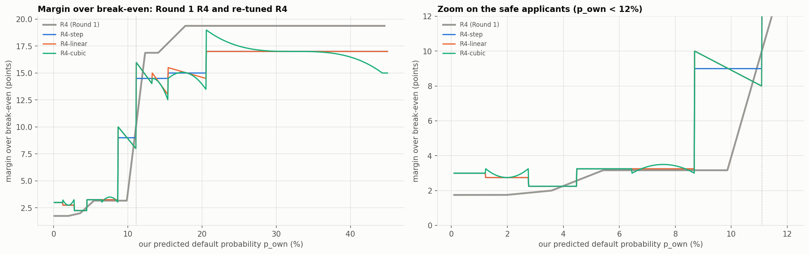
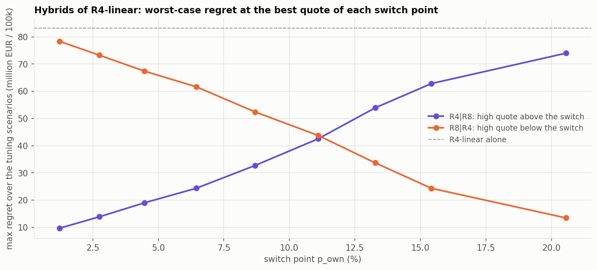
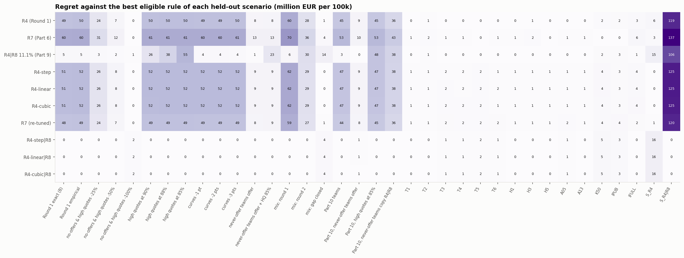
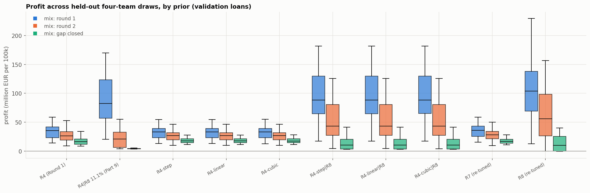
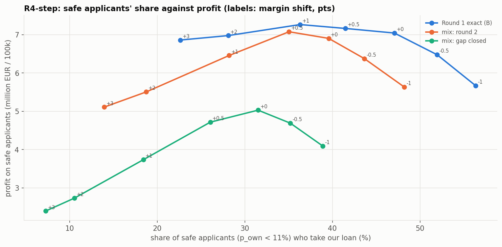
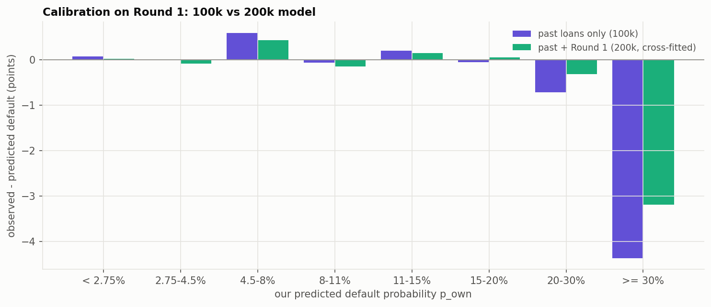

# Lending Game — Part 11: Improving our rule for Round 2

How we re-tuned our rule against the market revealed by Round 1, stress-tested it against competitors
who adapt, and chose the Round 2 rule. Everything comes from `analysis/round_2_rule.ipynb`; the code is
in `src/round_2_rule.py`.

Part 9 showed that the Round 1 profit was decided by the **uncontested applicants**: 20% of applicants
got no competitor offer, or only fixed quotes of 91.99% / 97.89%. Part 10 showed that **each competitor
slot is a mixture of four teams**, one of which never offered. Every team has now seen its diagnostic
file, so that pool may shrink and other teams may quote just under 90%. This part looks for a rule that
keeps most of the Round 1 gain without depending on it.

**Profits are per 100,000 applicants** (the size of a round), so that populations of different sizes
are comparable.

## Summary

- **Round 2 rule: R4-step|R8.**
  - **Below $p_{own} = 8.7\%$** (about half of the applicants): break-even plus 2.25–3.25 points.
  - **From 8.7%:** a flat **82%** quote, except above $p_{own} = 45\%$, where 82% is below our own
    break-even and we make no offer.
  - **The default model** is refitted on 200k loans.
- **It has the smallest max regret by far** over 36 held-out scenarios: **€15.7M**, against €106M
  for Part 9's R4|R8 and €119M for the Round 1 R4.
  - It also has the highest weighted profit (**€56.7M**, against €25.9M for R4) and a positive worst
    case.
  - The ranking holds without the Part 7 scenarios and without any single scenario.
- **On the real Round 1 market it would have made €82.3M**, against our €35.0M and the winner's
  €73.3M. It beats Part 9's hybrid by **+€4.6M**, significantly.
- **It survives the adaptations we can foresee.**
  - High quotes cut to 85% cost it nothing, since 82% is already below them.
  - It keeps €27M if the never-offer teams start lending, against €19M for R4.
- **Its cost:** when every competitor lends to the risky half at moderate rates, it earns **€1–4M
  less than R4 on average**, and up to €17M less in the worst draws. It is insurance with a premium.
- **Re-tuning R4's margins adds little.**
  - On contested markets the step, linear and cubic shapes are within €0.1M of each other.
  - All three are only €1.3M better than Round 1's R4.
- **The 82% quote is the main judgement call.** 80–85% are all defensible: a higher quote earns more
  if Round 1 repeats, a lower one if the other teams undercut.
- **Retraining on 200k loans** barely changes the predictions (correlation 0.9988). It corrects the
  over-prediction above 30% risk (from 4.4 to 3.2 points).

---

## 1. Method

### 1.1 Four teams per competitor slot

In the game, each applicant's competitor in slot 1 is one of four type-1 teams drawn at random, and
likewise for slot 2. Part 7's scenarios used one rule per slot, which missed the Round 1 market. Here
every scenario **draws four team rules per slot** and gives each applicant one of them at random.

The team rules come from a library based on Part 10:

| team type | rule (on the team's own default probability) | Round 1 team (Part 10) |
|---|---|---|
| never | never offers | 1A, 2A |
| curve | break-even + a safe margin below a switch (8–12.5%), + a risky margin above | 1C, 2C, 2D |
| cutoff | a curve, no offer from 10–20% | 1D |
| high quote | a curve, then a fixed quote from 5–12.5% | 1B, 2B |
| flat quote | one quote for everyone (a team copying R8) | — |
| copy R4 | our Round 1 R4 | — |
| copy R4\|R8 | R4 below 11.1%, a high quote above | — |

The competitors' default probabilities are our reconstructed lender 1 and 2 models, which see their
signals. So a team's no-offers and high quotes fall more often on borrowers who default, and the
winner's curse is kept.

**Three priors over the teams:**

| prior | teams per slot | what it represents |
|---|---|---|
| **round 1** | 25% each of never, high quote, curve and cutoff | Round 1 as Part 10 found it |
| **round 2** (central guess) | 8% never, 17% high quote, 30% curve, 15% cutoff, 10% each of the three copycats; high quotes 80–98% | teams adapting after their diagnostic file |
| **gap closed** | no never-offer or cutoff team; high quotes at 80–90%; cheaper curves | the uncontested pool is gone |

**Both checks pass.**

- **The "round 1" prior reproduces the Round 1 market's uncontested shares:** 5.5% among the safest
  applicants (real: 6.3%), and about half above 20% risk (real: 49%).
- **Part 10's eight teams, rebuilt as rules, reproduce the market on validation loans they never saw.**
  - Uncontested shares are within 1.5 points below 20% risk.
  - Every Round 1 rule's profit is within €1–5M of the real figure (R4: €31.5M vs €35.0M; R8:
    €113.8M vs €118.9M).

### 1.2 Tuning and held-out data

The Round 1 applicants are split in two halves. **Half A is used for tuning; half B and the 20,000
validation loans are never used in tuning.**

| tuning scenarios | population | weight |
|---|---|---|
| Part 10's empirical Round 1 scenario | Round 1, half A | 30% |
| its stresses: never-offer teams offer · no-offers & high quotes −50% · high quotes at 85% · curves −1 pt · no-offers & high quotes −100% | Round 1, half A | 30% |
| 30 draws of the "round 2" prior | 80,000 training loans | 25% |
| 20 draws of the "gap closed" prior | 80,000 training loans | 15% |

The empirical scenarios carry 60% of the weight, as the guidelines ask.

**Why the competitive rules are tuned on contested markets only.** On the full objective, every R4 bin's
margin ran to the top of the grid (40 points), even for 1% risk borrowers. As long as some
uncontested pool survives, a higher rate earns more everywhere, so the "re-tuned R4" became a disguised
high quote. The R4 variants and R7 are therefore tuned on the two **contested** markets, 50% each:
"no-offers & high quotes −100%" and the gap-closed mixtures. They answer one question: **how should we
price when there is competition?** Where to quote high instead is decided separately (section 3).

### 1.3 Candidate rules

| rule | what it is |
|---|---|
| R4, R7 (Round 1) | the Part 6 rules, fixed |
| R8 89.5%, R4\|R8 11.1%, R8\|R4 11.1% (Part 9) | Part 9's high quote and hybrids, fixed |
| **R4-step / linear / cubic** | R4's ten decile bins, with a constant, linear or cubic margin inside each bin, not forced to rise with risk |
| R7 re-tuned | the undercut rule on the contested markets |
| **R4-x\|R8** | each re-tuned R4 below a switch point, a flat quote above |
| R8 re-tuned | one flat quote for everyone, as a sanity check |

**R8 and R8|R4 are not candidates.** Quoting 80–90% to a 1% risk borrower ignores risk entirely and
works only while that borrower has no other offer. They stay in the tables for reference and do not
set the regret.

## 2. Pricing contested applicants

### 2.1 R4 with a step, linear or cubic margin

Inside each decile bin the margin over break-even is a polynomial in the applicant's position
$x \in [-1, 1]$ in the bin, tuned by coordinate descent:

$$r = be(p) + \sum_{j=0}^{d} c_{b,j}\,x^j, \qquad d = 0 \text{ (step)},\ 1 \text{ (linear)},\ 3 \text{ (cubic)}.$$

| | R4 (Round 1) | R4-step | R4-linear | R4-cubic |
|---|---|---|---|---|
| contested objective (in sample) | €11.57M | €12.91M | €12.94M | €12.99M |

**Margin of R4-step (points over break-even):**

| $p_{own}$ bin | 0–1.2% | 1.2–2.8% | 2.8–4.5% | 4.5–6.4% | 6.4–8.7% | 8.7–11.1% | 11.1–13.3% | 13.3–15.4% | 15.4–20.6% | ≥ 20.6% |
|---|---|---|---|---|---|---|---|---|---|---|
| R4-step | 3.0 | 2.75 | 2.25 | 3.25 | 3.25 | 9.0 | 14.5 | 14.5 | 15.0 | 17.0 |
| R4 (Round 1) | 1.75 | 1.75 | 2.0 | 3.2 | 3.2 | 3.2 → 10 | 16.9 | 16.9 | 19.4 | 19.4 |

- **The shape inside a bin does not matter.** Linear adds €0.04M and cubic €0.09M, in sample only. On
  held-out data the three are within €0.1M of each other everywhere. **The step is enough.**
- **Safe applicants should pay more than in Round 1:** 3 points below 1.2% risk, against 1.75, as Part
  9 found in hindsight.
- **Margins jump earlier** (9 points from 8.7%) **but are lower above 12%** (14.5–17 points, against
  16.9–19.4). In contested markets the competitors lend to risky applicants at moderate rates, so the
  25–32 points that paid in Round 1 (Part 9) no longer do.
- **Without the monotonicity constraint the curve dips** slightly at 2.8–4.5% risk (2.25 points). The
  dip is small and real in the tuning data.
- **The re-tuned R4 alone is not an improvement on held-out data.** It is €0.3–1.5M ahead of the
  Round 1 R4 in contested scenarios but €2.3M behind on the real Round 1 market, because it quotes
  risky uncontested applicants lower rates.

### 2.2 R7 re-tuned

The best R7 undercuts the cheaper competitor's predicted break-even (25th percentile) by 3 points, with
a risk adjustment of $a = 0.6$, the edge of the grid. Its contested objective (€11.95M) is below the
re-tuned R4's (€12.9M). On held-out data it is close to R4 (weighted €26.3M against €25.9M) and never
competitive with the hybrids. **Its extra machinery still does not pay.**

## 3. Where to quote high

### 3.1 R8 re-tuned

Against the Round 2 priors, the best flat quote falls from 89.5% to **80%**, the bottom of the assumed
range of copycat quotes. The level reflects our assumptions more than the data. R8 stays a sanity
check.

### 3.2 The hybrids

**On weighted profit, more high quote is always better**, as in Part 9. So the switch point and the
quote are chosen with **Part 7's main criterion**: the smallest max regret across the tuning scenarios.

**Even minimax regret picks the hybrid that quotes high to almost everyone:** a switch at 1.2% risk,
quote 82%, max regret €9.6M. The reason is an asymmetry:

- where an uncontested pool survives, a rule without a high quote gives up tens of millions of euros;
- where the pool is gone, quoting high costs only the thin contested margin, a few million euros.

**Our decision: a high quote is eligible only for risky applicants** ($p_{own} \ge 8.7\%$, the R4|R8
direction).

- **That is where Part 10 found the pool comes from real pricing choices** (high-quote and cutoff
  teams), which are likely to persist.
- **The safe pool came only from the two never-offer teams**, which may not exist in Round 2.
- **Pricing a 1% risk borrower at 82% is not a rule we can defend.**

Within that family, **all three R4 variants choose the same hybrid: switch at 8.7%, quote 82%**
(max regret €7.1M on the tuning scenarios). Step and linear even give the identical rule: they only
differ above 8.7%, where the quote replaces them.

## 4. Stress tests on held-out data

Every rule, parameters fixed, against 36 scenarios it was never tuned on:

| group | scenarios | population |
|---|---|---|
| Round 1 | the real offers and borrower types | Round 1, half B |
| empirical | Part 10's scenario and 11 stresses: no-offers & high quotes −25/−50/−100%, high quotes at 90/88/85%, curves −1/−2/−3 pts, never-offer teams offer (also with high quotes at 85%) | Round 1, half B |
| mixtures | 30 new draws of each prior | validation loans |
| Part 10 teams | the eight inferred teams; never-offer teams offer; high quotes at 85%; never-offer teams copy R4\|R8 at 85% | validation loans |
| Part 7 | T1–T6, H1/H3/H5, A05, A13, K50, IPUB, IFULL, S_R4 (both copy R4), S_R4\|R8 (both copy R4\|R8 at 89.5%) | validation loans |

**Weights for the weighted profit:**

- 3 for Round 1, the empirical scenario and the round 2 mixtures;
- 2 for the gap-closed mixtures and the Part 10 teams;
- 1 for each stress and Part 10 variant, and for the round 1 mixtures;
- 0.25 for each Part 7 scenario, the one-rule-per-slot structure that missed Round 1.

### 4.1 The criteria

| rule | max regret (main) | worst case | weighted profit | vs R4: pool gone (−100%) | vs R4: never-offer teams offer | vs R4: gap closed |
|---|---|---|---|---|---|---|
| **R4-step\|R8** | **€15.7M** | **+€0.3M** | **€56.7M** | −€1.3M | **+€8.0M** | −€2.4M |
| R4-linear\|R8 | €15.7M | +€0.3M | €56.7M | −€1.3M | +€8.0M | −€2.4M |
| R4-cubic\|R8 | €15.7M | +€0.2M | €56.7M | −€1.3M | +€8.0M | −€2.4M |
| R4\|R8 11.1% (Part 9) | €105.9M | +€0.3M | €43.6M | −€1.1M | +€7.2M | −€12.5M |
| R4 (Round 1) | €119.3M | −€2.0M | €25.9M | — | — | — |
| R7 re-tuned | €120.3M | −€1.2M | €26.3M | −€0.1M | −€0.3M | +€0.8M |
| R4-step | €125.0M | −€2.5M | €24.4M | +€0.3M | −€1.3M | +€1.5M |
| R7 (Part 6) | €137.4M | −€4.6M | €18.7M | +€0.3M | −€5.2M | −€2.8M |

### 4.2 Profit in the key scenarios

| rule | Round 1 (B) | empirical | high quotes at 85% | never-offer teams offer | pool gone (−100%) | mix: round 2 | mix: gap closed | Part 10 teams | S_R4 |
|---|---|---|---|---|---|---|---|---|---|
| **R4-step\|R8** | **€84.6M** | **€86.6M** | **€86.6M** | **€27.1M** | €3.3M | **€56.2M** | €14.9M | €75.6M | €4.2M |
| R4\|R8 11.1% (Part 9) | €80.1M | €81.9M | €31.9M | €26.4M | €3.5M | €25.9M | €4.7M | €72.4M | €4.9M |
| R4 (Round 1) | €35.9M | €36.8M | €36.6M | €19.2M | €4.6M | €28.0M | €17.3M | €30.4M | €13.8M |
| R4-step | €33.3M | €34.6M | €34.4M | €17.8M | €4.8M | €27.2M | €18.7M | €28.5M | €19.4M |
| R7 re-tuned | €36.7M | €38.0M | €37.4M | €18.9M | €4.5M | €28.7M | €18.1M | €31.3M | €18.4M |
| *R8 89.5% (Part 9)* | *€121.5M* | *€123.6M* | *€57.1M* | *€26.3M* | *€0.0M* | *€27.7M* | *€0.6M* | *€111.2M* | *€0.0M* |

- **The hybrid wins wherever any risky pool survives**, and by a lot: €56M against €28M for R4 in the
  round 2 mixtures.
- **Cutting the rival high quotes to 85–90% costs it nothing**, since 82% is already below them. The
  same cut costs Part 9's 89.5% hybrid €50M.
- **If the never-offer teams start lending, it still earns the most** (€27.1M, R4 €19.2M). The risky
  pool comes from the high-quote and cutoff teams, which stay.
- **Its max regret comes from S_R4:** if both competitors copy R4, no risky applicant is left
  uncontested and the 82% quote wins nothing (€4.2M against €19.4M for R4-step).
- **When the pool is gone** (−100%, gap-closed mixtures), it earns €1–4M less than R4.

**Spread over the held-out draws** (10th percentile of profit over 30 draws of each prior):

| rule | round 1 | round 2 | gap closed |
|---|---|---|---|
| R4-step\|R8 | €39.4M | €14.3M | €3.6M |
| R4 (Round 1) | €21.3M | €17.1M | €11.1M |
| R4-step | €20.1M | €17.4M | €12.4M |

The hybrid's bad draws are worse than R4's: €3M worse in the round 2 prior, €7–9M in the gap-closed
one.

### 4.3 Is the choice robust?

**It does not hinge on one scenario.** Max regret recomputed with fewer scenarios:

| rule | all 36 | without S_R4\|R8 | without the Part 7 scenarios |
|---|---|---|---|
| R4-step\|R8 | €15.7M | €15.7M | **€3.9M** |
| R4\|R8 11.1% (Part 9) | €105.9M | €54.7M | €54.7M |
| R4 (Round 1) | €119.3M | €59.7M | €59.7M |
| R4-step | €125.0M | €61.6M | €61.6M |

S_R4|R8, where both competitors quote 89.5% above 11.1% and our 82% wins every risky applicant
(€167M), inflates the other rules' regret, but the ranking is the same without it.

**Sensitivity to the quote and the switch point** (R4-step below the switch):

| variant | Round 1 (B) | high quotes at 85% | mix: round 2 | mix: gap closed | pool gone | S_R4 |
|---|---|---|---|---|---|---|
| quote 78% | €80.8M | €82.5M | €62.5M | €18.2M | €3.3M | €4.2M |
| quote 80% | €82.8M | €84.6M | €61.4M | €17.6M | €3.3M | €4.2M |
| **quote 82%** | **€84.6M** | **€86.6M** | **€56.2M** | **€14.9M** | **€3.3M** | **€4.2M** |
| quote 85% | €87.6M | €59.8M | €46.5M | €8.3M | €3.3M | €4.2M |
| quote 89.5% | €92.3M | €35.9M | €27.8M | €4.3M | €3.3M | €4.2M |
| switch 11.1% | €74.9M | €77.0M | €50.9M | €15.0M | €3.5M | €5.7M |
| switch 13.3% | €63.8M | €65.1M | €45.0M | €16.5M | €4.5M | €11.0M |
| R4-step alone | €33.3M | €34.4M | €27.2M | €18.7M | €4.8M | €19.4M |

- **The quote is a trade-off.**
  - **A higher quote earns more if Round 1 repeats:** 89.5% adds €7.6M on the real market. But it
    loses most of its pool if the high quotes are cut to 85%, and half of it in the round 2 mixtures.
  - **A lower quote (78–80%) earns €5–6M more in the round 2 mixtures** and €3M more in the gap-closed
    ones, but €2–4M less on Round 1.
  - **82% sits between them.** Between 80% and 82% the difference is a few million euros either way:
    a judgement, not evidence. The right quote is "just below the other teams' high quotes", and we
    can only guess their level.
- **The 8.7% switch beats every higher switch point unless the pool is gone.** Moving it to 11.1% or
  13.3% costs €10–21M on Round 1 and €5–11M in the round 2 mixtures. It gains €0.1–7M only where
  nobody is left uncontested.

**How often the high quote pays** (R4-step|R8 minus R4-step, per held-out draw):

| prior | hybrid ahead | mean difference | worst | best |
|---|---|---|---|---|
| round 1 | 97% of draws | +€61.5M | −€5.1M | +€137.6M |
| round 2 | 77% | +€29.0M | −€15.4M | +€111.4M |
| gap closed | 23% | −€3.9M | −€17.2M | +€43.4M |

**The hybrid is insurance with a premium**: it costs about €4M on average, and up to €17M, if the gap
closes completely. It gains €29–62M on average if the market looks like Round 1 or our Round 2 guess.

### 4.4 Is the lead real?

Paired bootstrap (500 resamplings) on half B of Round 1, with the real offers and borrower types:

| comparison | difference | 95% interval | resamples where the hybrid is ahead |
|---|---|---|---|
| R4-step\|R8 vs R4\|R8 11.1% (Part 9) | +€4.6M | [+€3.4M, +€5.7M] | 100% |
| R4-step\|R8 vs R4 (Round 1) | +€48.7M | [+€46.7M, +€50.9M] | 100% |

The lead is not noise in the defaults. It does assume the Round 1 competitors; sections 4.2–4.3 cover
competitors who change.

## 5. The real Round 1 market

The exact counterfactual of Part 9, on all 100,000 Round 1 applicants. Half A was seen in tuning, so
**half B (× 2) is the honest figure**:

| rule | profit | loans | share | profit per loan | half A × 2 (tuning) | half B × 2 (held out) |
|---|---|---|---|---|---|---|
| *R8 89.5% (Part 9)* | *€118.9M* | *20,328* | *20.3%* | *€5,850* | *€116.4M* | *€121.5M* |
| **R4-step\|R8** | **€82.3M** | 40,571 | 40.6% | €2,028 | €79.9M | **€84.6M** |
| R4\|R8 11.1% (Part 9) | €77.5M | 46,918 | 46.9% | €1,652 | €75.0M | €80.1M |
| R7 re-tuned | €36.2M | 46,491 | 46.5% | €778 | €35.7M | €36.6M |
| **R4 (submitted)** | **€35.0M** | 55,568 | 55.6% | €630 | €34.1M | €35.9M |
| R4-step | €32.7M | 51,735 | 51.7% | €632 | €32.1M | €33.3M |
| *Round 1 winner* | *€73.3M* | | | | | |

- **The chosen rule would have made €82.3M**, more than the winner, with 40.6% of the market.
- **R8 would still have made more (€118.9M)**, because it was tuned on that market. The hybrid gives
  up about €37M of it to keep its profit when the competitors adapt.
- **Half A and half B give similar figures**, so the tuning did not overfit the Round 1 defaults.

## 6. Market share against margin on safe applicants

The base rule's rates below 11% are shifted by −1 to +3 points:

| shift | Round 1 (B): profit | safe share | mix: round 2: profit | safe share | mix: gap closed: profit | safe share |
|---|---|---|---|---|---|---|
| −1 pt | €32.0M | 56% | €25.9M | 48% | €17.8M | 39% |
| −0.5 pt | €32.8M | 52% | €26.7M | 44% | €18.4M | 35% |
| **0 (tuned)** | **€33.3M** | **47%** | **€27.2M** | **40%** | **€18.7M** | **32%** |
| +0.5 pt | €33.5M | 42% | €27.4M | 35% | €18.4M | 26% |
| +1 pt | €33.6M | 36% | €26.8M | 28% | €17.4M | 18% |
| +2 pts | €33.3M | 28% | €25.8M | 19% | €16.4M | 11% |
| +3 pts | €33.2M | 23% | €25.4M | 14% | €16.1M | 7% |

- **Raising the safe margins moves profit by less than €0.6M** while halving the share. Market share
  is cheap to give up, but there is little to gain from it.
- **+0.5 point helps slightly if competitors stay as expensive as in Round 1** (+€0.1–0.2M), and the
  tuned margin is best in the gap-closed markets. **We keep the tuned margins.**

## 7. Retraining on 200k loans

The diagnostic file gives the default of all 100,000 Round 1 applicants, so our model (spline
logistic, public variables + `signal3`) can be refitted on 200,000 loans. Check, cross-fitted on
Round 1 (each fifth predicted by a model fitted on the past loans plus the other four fifths):

| $p_{own}$ band | applicants | default rate | gap, 100k model | gap, 200k model |
|---|---|---|---|---|
| < 2.75% | 19,615 | 1.36% | +0.07 pt | +0.02 pt |
| 2.75–4.5% | 10,482 | 3.60% | +0.00 pt | −0.08 pt |
| 4.5–8% | 17,036 | 6.76% | +0.59 pt | +0.43 pt |
| 8–11% | 12,625 | 9.42% | −0.06 pt | −0.15 pt |
| 11–15% | 18,745 | 13.17% | +0.19 pt | +0.15 pt |
| 15–20% | 10,519 | 17.26% | −0.05 pt | +0.05 pt |
| 20–30% | 9,158 | 23.14% | −0.72 pt | −0.32 pt |
| ≥ 30% | 1,820 | 30.82% | −4.37 pts | **−3.19 pts** |

(gap = observed default rate − mean prediction)

- **Overall the gain is negligible:** log-loss 0.2932 → 0.2930, AUC 0.7277 → 0.7279.
- **Calibration improves where it was off:** above 30% risk the over-prediction falls from 4.4 to 3.2
  points.
- **No under-prediction above 11% to correct.** As Part 9 found, that gap exists only on the loans we
  won: it is selection, which the margins pay for.
- **The Round 2 predictions of the two models correlate at 0.9988**, with the same mean (9.93%). With
  the 200k model, 50.3% of applicants are above the 8.7% switch, against 49.7% with the 100k model.

**Decision: price Round 2 with `p_own_200k`.** It uses twice the data and is better calibrated at the
top. The rule depends on $p_{own}$ only through the safe margins, where the two models agree, and the
switch point.

## 8. Conclusions

**The Round 2 rule: R4-step|R8**

| $p_{own}$ | 0–1.2% | 1.2–2.8% | 2.8–4.5% | 4.5–6.4% | 6.4–8.7% | ≥ 8.7% |
|---|---|---|---|---|---|---|
| rate | be + 3.0 pts | be + 2.75 pts | be + 2.25 pts | be + 3.25 pts | be + 3.25 pts | **82% flat** (no offer from 45.05%) |

- $be(p) = p/(1-p)$, rate floor 0.5%;
- **no offer when the quote is below our break-even**, $be(p_{own}) \ge 82\%$, i.e.
  $p_{own} \ge 0.82/1.82 = 45.05\%$: expected profit $(1-p)\,0.82 - p$ would be negative. This
  concerns 10 Round 2 applicants and replaces the general "no offer when $p_{own} \ge 50\%$";
- $p_{own}$ from the model refitted on 200k loans (`p_own_200k`).

**Why**

1. **Smallest max regret by far** (€15.7M, next €106M), highest weighted profit (€56.7M) and a
   positive worst case, over 36 held-out scenarios. This holds without the Part 7 scenarios.
2. **It would have made €82M in Round 1** (winner: €73M), €4.6M more than Part 9's hybrid,
   significantly.
3. **It survives the adaptations we can foresee:** high quotes cut to 85%, never-offer teams lending,
   cheaper curves.
4. **It only quotes high where the pool comes from real pricing choices** (high-quote and cutoff
   teams), not from the two never-offer teams that created the safe pool.

**What we learned**

5. **Re-tuning R4's margins is worth about €1M**, and a step inside each bin is enough: linear and
   cubic shapes add nothing out of sample.
6. **Safe applicants can pay more than in Round 1** (3 points instead of 1.75 at the lowest risk), but
   the share/margin trade-off is flat: ±0.5 point moves profit by less than €0.3M.
7. **Minimax regret alone would quote high to everyone.** Restricting the high quote to risky
   applicants is a deliberate economic choice, not a result of the criterion.
8. **Retraining on 200k loans is cheap and harmless**, but changes almost nothing.

**Judgement calls**

9. **The quote level.** 82% is a guess at "just below the other teams' high quotes". 80% is safer if
   teams undercut; 85% earns more if they do not.
10. **Whether to pay the insurance.** Plain R4 (or R4-step) is the better choice only if we believe
    every team will lend to the risky half at moderate rates. Then the hybrid costs €1–4M on average,
    and up to €17M.

**For Part 12:** the rule is saved in `data/pricing/final_rule_round2.json`. Rebuild it with
`r2.load_round2_rule()` and apply it to `p_own_200k` from
`data/predictions/applications_round2_own.csv`.

## 9. Limitations

- **The priors are ours.** The "round 2" and "gap closed" priors, and the range of rival high quotes
  (80–98%), are judgements. The 82% quote is chosen largely by them.
- **Half B shares the Round 1 competitors with half A.** It tests generalisation to new applicants,
  not to new competitors; the stresses and mixtures cover the latter.
- **Team behaviour is simplified** to step margins, cutoffs and flat quotes, rebuilt from Part 10's
  medians. The rebuilt teams under-state the risky uncontested pool by 4–6 points above 20% risk.
- **Nothing models other teams reasoning like us.** If several teams quote just below 85%, the quote
  becomes a price war that a fixed 82% may lose; S_R4 and the gap-closed draws bound that loss.
- **R7's risk adjustment sits at the edge of its grid** ($a = 0.6$).