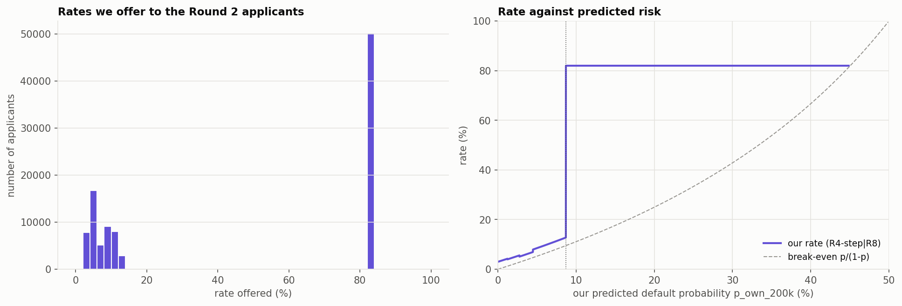

# Lending Game — Part 12: Pricing the Round 2 applications and the Round 2 submission

How the 100,000 Round 2 applicants were priced, how the submission file was built and checked, and
what it should earn. Everything comes from `analysis/submission_round_2.ipynb`; the code is in
`src/submission_round_2.py`.

## Summary

- **Submission file:** `submissions/Lender3_Round2_submission.csv`, with 100,000 rows (ids 100,001 to
  200,000) and columns `id` and `rate`.
  - **99,990 offers**, at rates from 3.02% to 82%;
  - **10 empty rates** (no offer).
- **Pipeline:**
  - **Predict:** our default probability comes from Part 11's model, refitted on 200k loans
    (`p_own_200k`).
  - **Price:** Part 11's rule **R4-step|R8** turns it into a rate.
  - Safer applicants ($p_{own} < 8.69\%$, 49.7% of the pool) get break-even + 2.25–3.25 points.
  - Riskier applicants (50.3%) get a flat **82%** quote; no offer from $p_{own} = 45.05\%$.
- **Every course rule is checked**, and every rate is checked against the saved rule, on the table
  and on the file read back from disk.
- **Expected profit:** about **€82M** if the competitors behave as in Round 1 (Round 1's R4: €34M),
  €25–26M if half the uncontested pool closes or the never-offer teams start lending, €4M if the pool
  closes entirely.

---

## 1. Predict

The Round 2 file (`data/raw/NewApplications_Lender3_Round2.csv`) has the same columns as Round 1,
with ids 100,001 to 200,000. Part 11 predicted $p_{own}$ for each applicant with our spline logistic
model (public variables + `signal3`), fitted twice:

- on the 100,000 past loans, as in Round 1 (`p_own_100k`);
- on the 200,000 loans now known, the past loans plus Round 1 (`p_own_200k`). **We price on this one**
  (Part 11, section 7).

Both are in `data/predictions/applications_round2_own.csv`.

| | Round 2, `p_own_200k` (priced) | Round 2, `p_own_100k` | Round 1 applicants |
|---|---|---|---|
| mean | 9.93% | 9.93% | 9.96% |
| median | 8.75% | 8.62% | 8.67% |
| 90th percentile | 20.3% | 20.5% | 20.5% |
| 99th percentile | 32.5% | 33.4% | 33.7% |
| maximum | 45.5% | 48.1% | 50.2% |

- **The Round 2 applicants look like the Round 1 applicants**, so the rule tuned on Round 1 applies
  without adjustment.
- **The 200k model is a little less extreme at the top.** Part 11 found the 100k model over-predicted
  above 30% risk; the refit corrects part of that.

**Does the model choice matter?** Barely:

| | value |
|---|---|
| correlation of the two predictions | 0.9988 |
| applicants above the 8.69% switch, 100k / 200k model | 49,724 / 50,261 |
| applicants that change side of the switch | 1,137 (1.1%) |
| mean rate change where both models give an offer | 0.9 point |

Almost all of the rate change comes from the 1,137 applicants that cross the switch point. On the
others the rate moves by a few hundredths of a point.

## 2. Price

**Rule R4-step|R8** (chosen in Part 11, saved in `data/pricing/final_rule_round2.json`, rebuilt with
`r2.load_round2_rule()`):

| $p_{own}$ | rate |
|---|---|
| 0 – 1.22% | break-even + 3.00 points |
| 1.22% – 2.75% | break-even + 2.75 points |
| 2.75% – 4.47% | break-even + 2.25 points |
| 4.47% – 6.45% | break-even + 3.25 points |
| 6.45% – 8.69% | break-even + 3.25 points |
| 8.69% – 45.05% | **82% flat** |
| 45.05% and above | no offer |

with break-even $be(p) = p/(1-p)$ and a rate floor of 0.5%.

- **Below the switch we compete.** On safe applicants the curve teams of Round 1 priced 1.4–3 points
  over break-even (Part 10), so this is where we expect to win loans at a thin margin.
- **Above the switch we quote 82%**: just under the rival high quotes of Round 1 (91.99%, 97.89%) and
  the 85% they might cut to. It wins where no competitor offers or where they only quote high. Part 10
  found that this risky pool comes from real pricing choices (high-quote and cutoff teams), which are
  likely to persist.
- **No offer from $p_{own} = 0.82/1.82 = 45.05\%$:** there 82% is below our own break-even, and the
  expected profit $(1-p)\,0.82 - p$ would be negative. This replaces the general "no offer when
  $p \ge 50\%$" rule.

**Resulting offers:**

| $p_{own}$ band | applicants | offers | average rate | lowest – highest | average margin |
|---|---|---|---|---|---|
| 0 – 1.2% | 9,344 | 9,344 | 3.6% | 3.0 – 4.2% | 3.00 pts |
| 1.2 – 2.8% | 10,086 | 10,086 | 4.8% | 4.0 – 5.6% | 2.75 pts |
| 2.8 – 4.5% | 9,943 | 9,943 | 6.0% | 5.1 – 6.9% | 2.25 pts |
| 4.5 – 6.4% | 10,050 | 10,050 | 9.0% | 7.9 – 10.1% | 3.25 pts |
| 6.4 – 8.7% | 10,316 | 10,316 | 11.4% | 10.1 – 12.8% | 3.25 pts |
| 8.7 – 15% | 28,850 | 28,850 | 82% | 82% | 68 pts |
| 15 – 30% | 19,863 | 19,863 | 82% | 82% | 56 pts |
| 30 – 45.05% | 1,538 | 1,538 | 82% | 82% | 29 pts |
| 45.05% and above | 10 | 0 | — | — | — |

- **10 applicants get no offer**, all with $p_{own}$ between 45.05% and 45.5% (ids 117571, 126532,
  140346, 145592, 158080, 176844, 182739, 188208, 192515, 199333).
- **The 0.5% floor never binds:** the lowest rate offered is 3.02%.
- **Every offer is above our break-even**, so every loan has a positive expected profit under
  $p_{own}$.

## 3. Submit and check

The submission table is built and written with the Round 1 functions (`make_submission`,
`write_submission`: 6 decimals, empty cell for no offer). Two checks run on the table and again on the
file read back from disk:

- **`check_submission` (course format):** exactly the columns `id` and `rate`; every id from 100,001
  to 200,000 exactly once and nothing else; every rate empty or a decimal in (0, 1].
- **`check_rule` (the rule itself):** each rate is recomputed from the JSON alone, without the Part 11
  code, and must match the submitted one. It also checks that no offer is below our break-even.

| | value |
|---|---|
| applications | 100,000 |
| offers | 99,990 |
| of which break-even + margin | 49,739 |
| of which the 82% quote | 50,251 |
| no offer (empty rate) | 10 |
| lowest / median / highest rate | 3.02% / 82% / 82% |

The file read back has the same ids, the same rates to 6 decimals and 10 empty cells.

## 4. What should it earn?

A preview. Defaults are drawn from $p_{own}$ (10 draws). The competitors' offers are resampled from the
Round 1 market given risk and default, using Part 10's empirical scenario and its stresses. Profit is
averaged over the three borrower types.

| rule | Round 1 repeats | never-offer teams offer | high quotes at 85% | no-offers & high quotes −50% | curves −1 pt | pool gone (−100%) |
|---|---|---|---|---|---|---|
| **R4-step\|R8 (submitted)** | **€82.3M** | **€26.0M** | **€82.3M** | **€25.1M** | **€80.1M** | €3.9M |
| R4-step (no quote) | €32.2M | €17.4M | €32.2M | €17.2M | €29.7M | €6.3M |
| R4 (Round 1) | €34.3M | €18.4M | €34.3M | €17.7M | €32.4M | €5.6M |

Loans won by the submitted rule: 40,305 if Round 1 repeats (40% of applicants), 17,035 if the pool is
gone.

- **If Round 1 repeats, about €82M**, the same as the rule's exact Round 1 counterfactual in Part 11
  (€82.3M): the new applicants change nothing. One draw of the defaults moves it by about ±€1M.
- **High quotes cut to 85% cost nothing**, since 82% is already below them; cheaper curves cost about
  €2M.
- **If the never-offer teams lend, or half the pool closes**, profit falls to €25–26M, still €8M more
  than R4.
- **If the pool closes entirely**, the rule makes €3.9M against €5.6–6.3M without the quote. This is
  the insurance premium Part 11 accepted.

## 5. Limitations

- **The preview assumes the Round 1 competitors**, changed only through the stress knobs. Teams
  quoting just below 82%, or copying our Round 1 rules, are not in it. Part 11 covers those cases
  (S_R4: €4.2M).
- **The scenario bins on $p_{own}$.** The Round 1 donors were binned on the 100k model and the Round 2
  applicants on the 200k model. The two correlate at 0.9988, so the effect is small.
- **The defaults are simulated from $p_{own}$**, which assumes it is calibrated. Part 9 checked that
  on Round 1, and Part 11 checked it for the 200k model.

## 6. Deliverables

| file | content |
|---|---|
| `submissions/Lender3_Round2_submission.csv` | the submission: `id`, `rate` (empty = no offer) |
| `src/submission_round_2.py` | loading the Round 2 applicants, pricing, rule table, `check_rule`, model comparison, profit preview; reuses the Round 1 format functions |
| `analysis/submission_round_2.ipynb` | the analysis behind this report |
| `report/figures/fig32_round2_rates.png` | distribution of our rates and rate against predicted risk |
